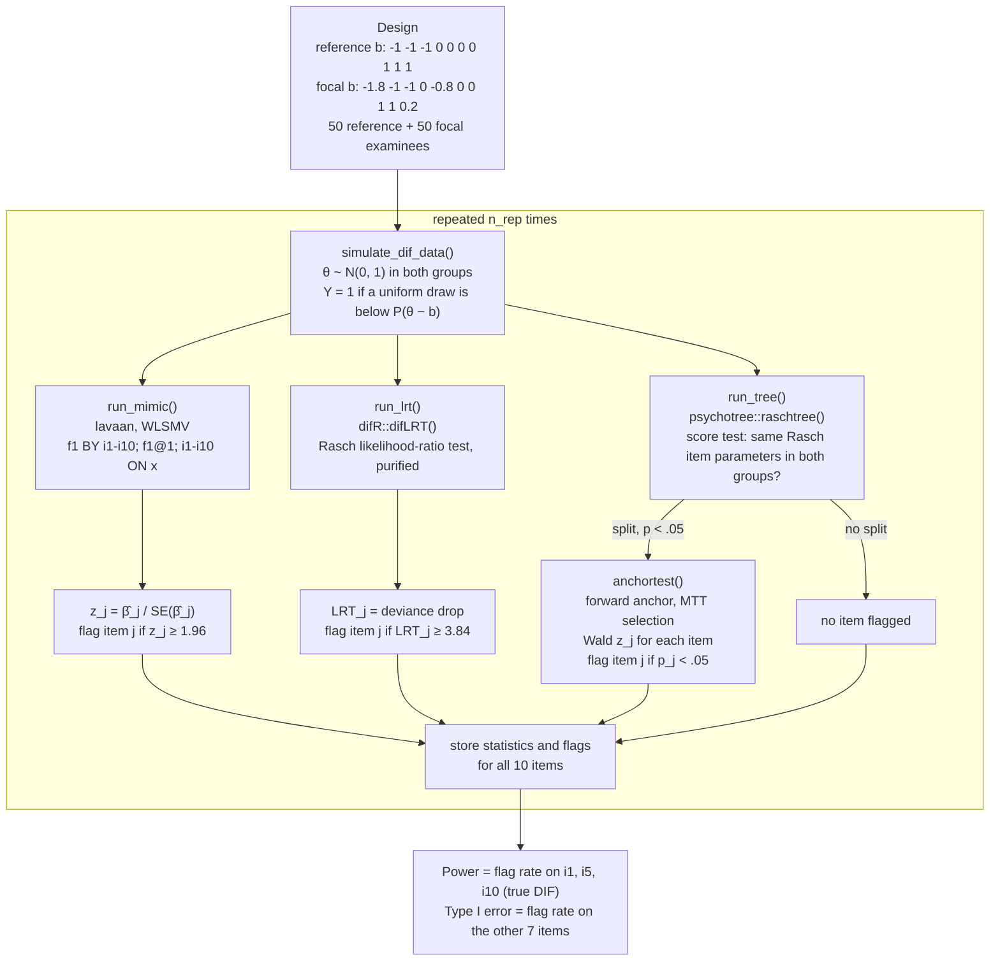
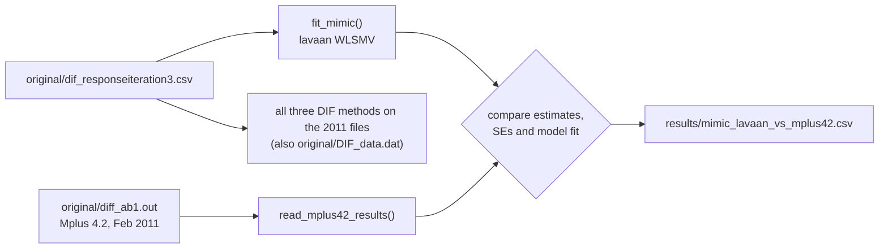
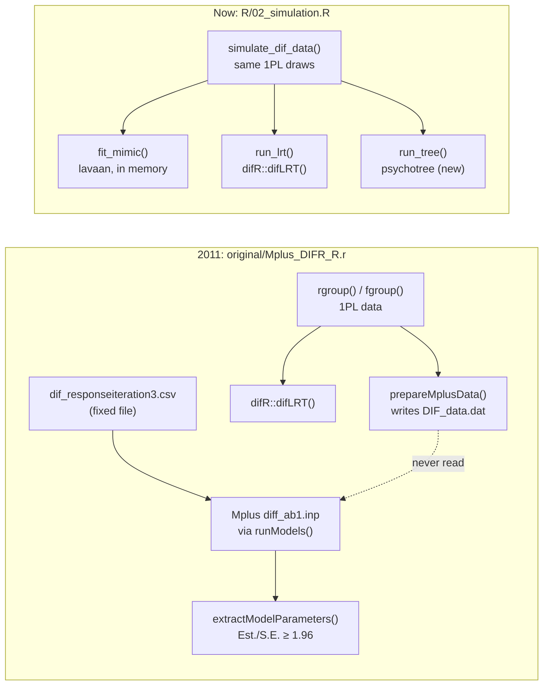

# Methods: the models, the math, and how the code fits together

This note covers three things:

- how the data are generated;
- how each of the three DIF methods models those data, and what each tests: MIMIC, the IRT
  likelihood-ratio test (difLRT), and the Rasch tree added in this rebuild;
- how the R code carries this out, with flow charts.

[difLRT.md](difLRT.md) covers difR's likelihood-ratio test in more detail.

## 1. How the pieces fit

### One replication of the simulation (`R/02_simulation.R`)



### Checking lavaan against Mplus before simulating (`R/01_single_dataset.R`)

This check ran in the author's development repository; the 2011 files and the script are not
part of this repository ([rebuild.md](rebuild.md)). Its output is in
[`results/01_single_dataset_output.txt`](../results/01_single_dataset_output.txt) and
[`results/mimic_lavaan_vs_mplus42.csv`](../results/mimic_lavaan_vs_mplus42.csv).



### 2011 pipeline vs. this rebuild



The 2011 loop ran Mplus as an external program, through files: write the data, run Mplus, read
its output back. The input file pointed at a fixed CSV rather than the file the loop wrote, so
every replication's MIMIC result came from the same data. lavaan fits the model in memory, on
the data the loop just generated, so that file hand-off is gone.

## 2. The data-generating model: Rasch (1PL)

For examinee *i* in group *x_i* (0 = reference, 1 = focal) and item *j*:

```math
P(Y_{ij} = 1 \mid \theta_i) = \frac{\exp(\theta_i - b_{j,x_i})}{1 + \exp(\theta_i - b_{j,x_i})},
\qquad \theta_i \sim N(0, 1) \text{ in both groups.}
```

- **Uniform DIF on three items.** For i1, i5 and i10, $`b_{j,\text{focal}} = b_{j,\text{ref}} - 0.8`$.
  These items are 0.8 logits easier for the focal group at every ability level.
- **No DIF elsewhere.** The other seven items have equal difficulty in both groups.
- **No impact.** Both groups have the same ability distribution.

In the code, `respon_1pl()` draws one uniform number per response and scores the item correct
when the number falls below the model probability:
`Y = (runif(n * k) < plogis(theta - b))`.

## 3. MIMIC (Mplus in 2011, lavaan now)

### The model

Each binary item is treated as a cut-off version of a continuous latent response $`y^*_{ij}`$:

```math
y^*_{ij} = \lambda_j \eta_i + \beta_j x_i + \varepsilon_{ij},
\qquad Y_{ij} = 1 \text{ if } y^*_{ij} > \tau_j ,
```

with $`\eta_i \sim N(0, 1)`$ and $`\varepsilon_{ij} \sim N(0, 1 - \lambda_j^2)`$. In the delta
parameterization, the variance of $`y^*`$ given $x$ is fixed at 1. So

```math
P(Y_{ij} = 1 \mid \eta_i, x_i) = \Phi\!\left(\frac{\lambda_j \eta_i + \beta_j x_i - \tau_j}{\sqrt{1 - \lambda_j^2}}\right).
```

| Mplus (`diff_ab1.inp`) | lavaan (`mimic_syntax()`) | Parameter |
|---|---|---|
| `f1 BY i1* i2-i10;` | `f1 =~ NA*i1 + i2 + ... + i10` | loadings $`\lambda_j`$, all free |
| `f1@1;` | `f1 ~~ 1*f1` | factor variance fixed at 1 |
| `i1 ON x; ... i10 ON x;` | `i1 ~ x` ... `i10 ~ x` | direct effects $`\beta_j`$: the DIF parameters |
| (thresholds, automatic) | (thresholds, automatic) | $`\tau_j`$ |
| no `f1 ON x` | no `f1 ~ x` | group means on the factor assumed equal |

### What β_j means in IRT terms

Rewrite the probability in normal-ogive IRT form:

```math
P = \Phi\!\Big(a_j\big[\eta_i - (b_j - \tfrac{\beta_j}{\lambda_j} x_i)\big]\Big),
\qquad a_j = \frac{\lambda_j}{\sqrt{1 - \lambda_j^2}},\quad b_j = \frac{\tau_j}{\lambda_j}.
```

So the focal group's difficulty is $`b_j - \beta_j / \lambda_j`$:

- $`\beta_j > 0`$: the item is easier for the focal group, which is uniform DIF in the direction simulated here.
- $`\beta_j = 0`$: no DIF.

The test is $`z_j = \hat\beta_j / SE(\hat\beta_j)`$. The 2011 rule flags item *j* when
$`z_j \ge 1.96`$, a one-sided test at α = .025.

### How WLSMV estimates it

WLSMV fits the model in three stages:

1. **Probit regressions.** Each item is regressed on `x` by probit regression, giving
   thresholds and slopes.
2. **Residual correlations.** For each pair of items, a tetrachoric correlation is estimated
   conditional on `x`.
3. **Weighted least squares.** Stack these sample statistics in a vector $s$ and choose the
   model parameters to minimise
   $`F = (s - \sigma(\vartheta))^\top W_D^{-1} (s - \sigma(\vartheta))`$, where $`W_D`$ is the
   diagonal of the statistics' asymptotic covariance matrix. Standard errors come from a robust
   (sandwich) formula, and the χ² test is mean- and variance-adjusted.

Mplus 4.2 and lavaan carry out the same steps, which is why their estimates agree to within 0.001.

### Why MIMIC power is only about .35 here

Back-of-envelope, from the model alone:

- **Rasch on the probit scale.** A logistic curve is close to a normal ogive with slope
  1/1.7, so a Rasch item has $a \approx 0.59$. That corresponds to a loading
  $\lambda = a / \sqrt{1 + a^2} \approx 0.51$.
- **The DIF size as β.** A 0.8-logit shift in difficulty corresponds to
  $`\beta = 0.8\,\lambda \approx 0.41`$.
- **The standard error.** With 50 + 50 examinees, $SE(\hat\beta) \approx 0.26$ (0.25–0.28 in
  the 2011 Mplus output).
- **Expected z.** About $0.41 / 0.26 \approx 1.56$, so
  $P(z \ge 1.96) \approx P(Z \ge 0.40) \approx .34$.

The simulation agrees. Over 1,000 replications (8 runs of 125, seeds 101–108):

| | expected | simulated |
|---|---|---|
| mean z, DIF items | 1.56 | 1.57 |
| power (flag rate, DIF items) | .34 | .35 |
| mean z (SD), no-DIF items | 0 (1) | 0.03 (1.00) |

The low power is a sample-size limit, not a coding problem.

## 4. IRT likelihood-ratio test (difR::difLRT)

The Rasch model with a DIF term for item *j*:

```math
\mathrm{logit}\, P(Y_{ij} = 1 \mid \theta_i) = \theta_i - b_j - \delta_j x_i .
```

- **The DIF parameter.** $`\delta_j`$ is the difference between the focal and reference
  difficulties; it is −0.8 for the DIF items here.
- **Two fits per item.** A compact model fixes $`\delta_j = 0`$, and an augmented model frees it.
  The anchor items have $\delta = 0$ in both models. That links the two groups' scales, so a
  difference in group mean ability is not mistaken for DIF.
- **The test.** $`LRT_j = -2(\ell_\text{compact} - \ell_\text{augmented}) \sim \chi^2(1)`$ under
  no DIF. Item *j* is flagged when $`LRT_j \ge 3.84`$, a two-sided test at α = .05.
- **Purification.** Flagged items are dropped from the anchor set, and the tests are repeated
  until the flagged set stops changing ([difLRT.md](difLRT.md)).

## 5. Rasch tree (psychotree), added in this rebuild

The Rasch tree (Strobl, Kopf, & Zeileis, 2015) works in two steps.

**Step 1: the tree, a global DIF test.** Fit the Rasch model to all 100 examinees by conditional
maximum likelihood. With 10 items there are 9 free difficulties; the first item is fixed at 0.
Each examinee's score vector $`s_i = \partial \ell_i / \partial b`$ at the estimate measures how much
that person pulls on each item parameter. If the parameters are the same in both groups, the
scores summed within each group should be near zero. The test statistic is

```math
\chi^2_\text{tree} = \sum_{g \in \{R, F\}} \frac{1}{n_g}\, S_g^\top \hat J^{-1} S_g,
\qquad S_g = \sum_{i \in g} s_i,\quad \hat J = \frac{1}{n}\sum_i s_i s_i^\top ,
```

which is χ²(9) when there is no DIF. If p < .05, the tree splits on group. With a single binary
covariate it can split only once, so here the tree is a global DIF test across all items. On the
2011 data file it gives χ² = 18.50, p = .030, and splits.

**Step 2: anchored Wald tests, which items.** If the tree split, estimate the difficulties
separately in each group, $`\hat b^R_j`$ and $`\hat b^F_j`$, and put them on a common scale using an
anchor set *A* of items presumed DIF-free:

```math
d_j = \hat b^R_j - \big(\hat b^F_j + c\big),\qquad c = \frac{1}{|A|}\sum_{a \in A}\big(\hat b^R_a - \hat b^F_a\big),
\qquad z_j = \frac{d_j}{SE(d_j)} .
```

- **Choosing the anchor.** `anchortest()` uses the iterative forward class with MTT selection
  (Kopf, Zeileis, & Strobl, 2015). It ranks items by how DIF-free they look when each item in
  turn serves as a single anchor, then adds items to the anchor in that order.
- **The flag.** Item *j* is flagged when the two-sided p < .05. A positive z means the item is
  easier for the focal group. The first anchor item fixes the scale, so it gets no test and is
  counted as not flagged.
- **No split, no flags.** If the tree did not split, no item is flagged.
- **Random tie-breaking.** `anchortest()` breaks ties between equally good anchor candidates at
  random. So the simulation gives each replication its own seed for the tree, and restores the
  random-number state afterwards so the data sets don't change.

**Results, 1,000 replications** (the same data sets for both methods; 8 runs of 125, seeds 101–108):

| | Rasch tree | MIMIC |
|---|---|---|
| tree split (global DIF detected) | 28.7% | — |
| power (DIF items) | .121 | .348 |
| Type I error (no-DIF items) | .041 | .026 |
| power, among replications where the tree split | .42 | — |
| Type I error, among replications where the tree split | .14 | — |

The tree is held back by its first step. Its global χ²(9) test spreads its power over all nine
parameters while the DIF sits in three items, so with 100 examinees it splits only 29% of the
time. When it does split, it has picked out samples with larger chance differences, so clean
items are flagged 14% of the time. Overall, Type I error stays near .05 because splits are infrequent.

This design doesn't play to the tree's strength. The tree's advantage is finding which groups
show DIF when there are several covariates, such as age, gender or school, without specifying
the groups in advance. MIMIC and the LRT need the groups fixed beforehand. Here there is only
one binary group variable, which is given. Adding covariates to the design would test that
advantage directly.

## 6. Why difR, lavaan and psychotree

**difR** for the IRT likelihood-ratio test:

- **The standard package.** It is the peer-reviewed R package for dichotomous DIF (Magis et al.,
  2010), with about ten DIF methods behind one interface, and purification built in.
- **The reference IRT method.** The IRT likelihood-ratio test (Thissen et al., 1988) is the
  method MIMIC is usually compared with (e.g., Finch, 2005).
- **The right model.** The Rasch test matches the data-generating model, so it is a
  correct-model benchmark. MIMIC also estimates a loading for every item.
- **Faithful to 2011.** The original code used `difLRT()`, so keeping it keeps the replication faithful.

**lavaan** in place of Mplus:

- **The same model.** Same specification, same WLSMV estimator; verified against the 2011
  output to within 0.001.
- **In memory.** It runs inside the R loop, with no data files to write, external program to
  call, or output to parse. That removes the step where the 2011 bug happened.
- **Free.** Anyone can rerun the study without an Mplus licence.

**psychotree** for the tree:

- **The established DIF tree.** It is the reference implementation of Rasch trees, by the
  method's authors, with anchor selection for item-level tests in its companion package psychotools.
- **Fast.** About 0.02 seconds per replication.

## 7. How the Rasch tree relates to the 2008 classification trees

Vaughn and Wang (2008) compared classification trees (CART) with linear discriminant analysis
and logistic regression. This rebuild borrows its Monte Carlo approach:

- simulate in R;
- verify the code against known results before simulating;
- use enough replications (1,000 per condition) for stable error rates;
- report error rates for each method.

The paper notes that a psychometrician might want to classify an item as a DIF item. The Rasch
tree uses the same recursive binary splitting as CART, applied to a measurement model:

| | CART (Vaughn & Wang, 2008) | Rasch tree |
|---|---|---|
| What a node holds | a class label (the predicted group) | a Rasch model (item difficulties) |
| How a split is chosen | the largest drop in Gini impurity | the most significant parameter-instability test |
| When splitting stops | nodes too small to split; optional pruning by cross-validation | no test significant at α |
| What the tree tells you | how to classify a new case | which groups of examinees have different item difficulties |

## References

Finch, H. (2005). The MIMIC model as a method for detecting DIF: Comparison with Mantel-Haenszel,
SIBTEST, and the IRT likelihood ratio. *Applied Psychological Measurement, 29*(4), 278–295.

Kopf, J., Zeileis, A., & Strobl, C. (2015). A framework for anchor methods and an iterative forward
approach for DIF detection. *Applied Psychological Measurement, 39*(2), 83–103.

Magis, D., Béland, S., Tuerlinckx, F., & De Boeck, P. (2010). A general framework and an R package
for the detection of dichotomous differential item functioning. *Behavior Research Methods, 42*(3), 847–862.

Strobl, C., Kopf, J., & Zeileis, A. (2015). Rasch trees: A new method for detecting differential
item functioning in the Rasch model. *Psychometrika, 80*(2), 289–316.

Thissen, D., Steinberg, L., & Wainer, H. (1988). Use of item response theory in the study of group
differences in trace lines. In H. Wainer & H. I. Braun (Eds.), *Test validity* (pp. 147–169). Erlbaum.

Vaughn, B. K., & Wang, Q. (2008). Classification based on tree-structured allocation rules.
*The Journal of Experimental Education.*
