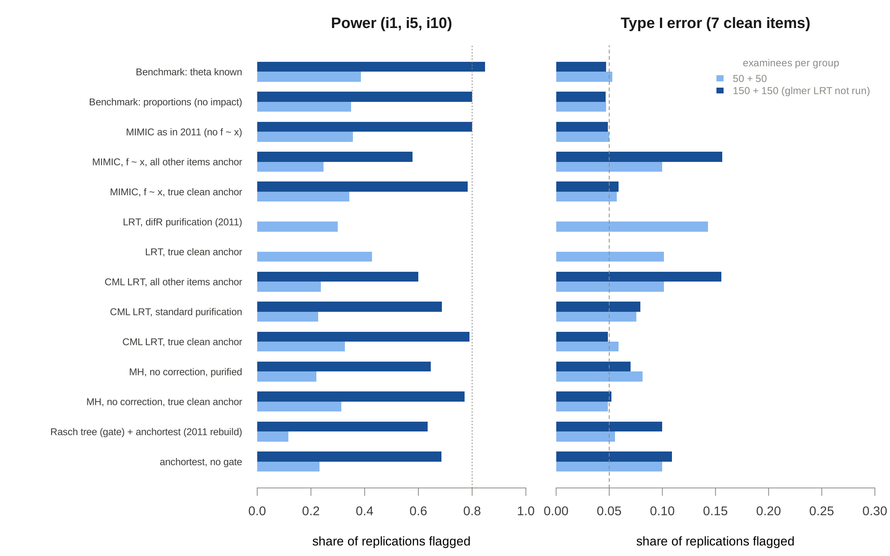

# Why power is low, and how to raise it

**Status: diagnosis and plan; pilot done. The full study (section 7) has been run: results in
[power_study.md](power_study.md).**

This document asks why all three methods have low power in the 1,000-replication run (MIMIC .35,
IRT-LR .32, Rasch tree .12). It covers the math of how much power 50 + 50 examinees can give at
best, why each method falls where it does, what the literature says, and a plan to raise power,
with the math of each lever.

## In short

1. **The design caps power at about .39, whatever the method.** With 50 + 50 examinees and 0.8
   logits of DIF, a test that *knows every examinee's θ* has power .34–.43 per item, .39 on
   average. Realistic tests reach .30–.38. For .80, 140–180 per group are needed, depending on the item (section 2).
2. **MIMIC's .35 is that ceiling, and it is a two-proportion test.** As specified in 2011 (all ten
   direct effects free, no `f1 ON x`), WLSMV estimates each direct effect from that item's two
   group proportions. It uses no other item. Its power is exactly the two-proportion power, and its
   Type I error is nominal only because the true group means are equal (section 3.1).
3. **The IRT-LR's .32 is bought with false positives, from three sources** (sections 3.2, 5):
   - *Its statistic is not a likelihood ratio.* difR takes the difference of lme4's `deviance()`,
     which for a GLMM is a conditional deviance. With no DIF at all, it averages 1.17–1.26
     instead of 1 and rejects 6–8% of the time. The true likelihood ratio from the same fits
     averages 1.00.
   - *Contamination.* All three DIF items favour the focal group, so with all other items as the
     anchor the focal group looks 0.23 logits more able. Each clean item then appears to have
     −0.26 logits of DIF, and each DIF item shrinks from 0.8 to about 0.63. This does not shrink
     with n: the Type I error grows to .26 at 300 per group.
   - *difR's purification.* Flagged items are dropped and never re-tested, so false flags only
     accumulate.

   At a true 5% error rate the LRT's power is **.17**.
4. **The tree must pass two tests in a row.** Its global 9-df test splits on group in only 29% of
   replications, and the item tests after a split find a DIF item 42% of the time (section 3.3).
5. **Levers, by payoff** (section 6): more examinees; a valid anchor; a pre-specified test of the
   suspected items together (power .70 at 50 + 50, .80 at 64 per group); directional tests; a
   correctly computed LRT with correct purification; and, for the tree, dropping the gate when the
   grouping is known.
6. **The pilot confirms the math** (section 5). On the same data sets, the exact predictions match
   the simulated rates to within about .02, at 50 and at 150 per group.

## 1. The design and the results checked

10 Rasch items, b = (−1, −1, −1, 0, 0, 0, 0, 1, 1, 1); 50 reference + 50 focal, θ ~ N(0, 1) in
both groups; uniform DIF of 0.8 logits on i1, i5 and i10, all easier for the focal group. The
laptop run (8 seeds × 125 replications) was checked from its stored statistics: the summary
reproduces exactly from the 30,000 rows; no data set is repeated; no fit failed; MIMIC's z on
clean items has mean 0.03 and SD 1.00.

| Method (2011 flag rule) | Power | Type I error | Power at a true 5% error rate* |
|---|---|---|---|
| MIMIC (z ≥ 1.96, one-sided α = .025) | .348 | .026 | .347 (two-sided, \|z\| ≥ 1.97) |
| IRT-LR (difLRT, purified, LRT ≥ 3.84) | .323 | .122 | **.170** (LRT ≥ 5.74) |
| Rasch tree + anchored Wald (p < .05) | .121 | .041 | |

\*The critical value at which the 7 clean items are flagged in 5% of replications (size-adjusted
power).

## 2. How much power can 50 + 50 examinees give?

The model for item j, with x = 1 for the focal group:

```math
\mathrm{logit}\, P(Y_{ij} = 1 \mid \theta_i) = \theta_i - b_j + \delta_j x_i ,
```

with δ_j > 0 meaning easier for the focal group (δ = 0.8 for i1, i5, i10). Three amounts of
information about δ_j, from most to least:

**(a) θ known: the absolute ceiling.** Each examinee contributes $P(1-P)$ to the information
about δ_j. Averaged over θ ~ N(0, 1), $`I(b) = E_\theta[P(1-P)]`$ is .207 at b = 0, .188 at
b = −0.8, .178 at b = ±1 and .129 at b = −1.8. So

```math
\mathrm{Var}(\hat\delta_j) = \frac{1}{n_R I(b_{jR})} + \frac{1}{n_F I(b_{jF})},\qquad
z_j = \frac{\delta_j}{\sqrt{\mathrm{Var}(\hat\delta_j)}} .
```

For i5: $\mathrm{Var} = 1/(50 \times .207) + 1/(50 \times .188) = .203$, z = 0.8/0.451 = 1.77,
power .43 (two-sided α = .05).

**(b) θ unknown, equal group means assumed: the item's own proportions.** If every item may have
DIF, the other items are outcomes of group membership, not covariates, so they carry no
information about δ_j. What is left is item j's two-by-two table. With $`\bar p_g = E_\theta[P_{jg}]`$,

```math
z_j = \frac{\mathrm{logit}\,\bar p_F - \mathrm{logit}\,\bar p_R}
{\sqrt{1/(n_R\,\bar p_R(1-\bar p_R)) + 1/(n_F\,\bar p_F(1-\bar p_F))}} ,
```

1.61 for i5 (power .37). A full-information maximum-likelihood Rasch model with the group means
fixed equal and all ten DIF parameters free gives the same z to two decimals (1.62), which
confirms the point: under this assumption, nothing beyond the item's own table is informative.

**(c) θ unknown, impact estimated, a clean anchor: the anchor-based ceiling.** The anchor items
(here, the 7 truly clean ones) fix the group difference in θ, and the LRT compares the model with
and without δ_j. Its noncentrality, computed exactly from the population (below), is 2.77 for i5
(power .38).

**How these are computed.** With 10 binary items there are only 2¹⁰ = 1,024 response patterns, so
each group's pattern probabilities can be computed exactly by integrating over θ. Fitting a model
to them, weighted by the group sizes, gives its pseudo-true parameters, and twice the gain in
expected log-likelihood is the LRT's noncentrality λ (results in `results/power/exact_*.csv`; the
code, `R/power/exact_power.R`, is released with the follow-up study). Then power = $`P(\chi^2_1(\lambda) > 3.84)`$, and λ grows in proportion to n.

| Item | b (ref → focal) | (a) θ known | (b) proportions, no impact (= MIMIC 2011) | (c) clean anchor | all other items as anchor (= difLRT) |
|---|---|---|---|---|---|
| i1 | −1 → −1.8 | .34 | .30 | .31 | .21 |
| i5 | 0 → −0.8 | .43 | .37 | .38 | .27 |
| i10 | 1 → 0.2 | .42 | .36 | .38 | .26 |
| mean | | **.39** | **.34** | **.36** | **.25** |
| clean items (Type I) | | .05 | .05 | .05 | **.080–.087** |

**Examinees per group needed for power .80** (two-sided α = .05):

| Item | θ known | proportions | clean anchor | all other items as anchor |
|---|---|---|---|---|
| i1 | 165 | 193 | 181 | 297 |
| i5 | 125 | 151 | 142 | 221 |
| i10 | 129 | 155 | 146 | 226 |

**Other DIF sizes** (item i5, clean anchor): for .80 power, 0.4 logits needs 554 per group,
0.5 needs 356, 0.6 needs 249, 0.8 needs 142 and 1.0 needs 93. At 50 + 50 the power is .13, .18,
.24, .38 and .54.

**A small focal group cannot be offset by a large reference group.** The focal term in
Var(δ̂) does not shrink when n_R grows. With 50 focal examinees and θ known, i5's power is .43 at
n_R = 50, .53 at 100, .60 at 200, .65 at 500, and at most .69 as n_R → ∞.

So the answer to "shouldn't MIMIC and the LRT do better than .3?" is no, not at 50 + 50: .35 is
what an honest test can reach, and .39 is what a test that knew θ would reach.

## 3. Why each method falls where it does

### 3.1 MIMIC (2011 specification): a two-proportion test

$`y^*_{ij} = \lambda_j\eta_i + \beta_j x_i + \varepsilon_{ij}`$, η ~ N(0, 1) in both groups (no
`f1 ON x`), all ten β_j free. With every β_j free, the model's mean structure is saturated: item
j's threshold and β_j reproduce its two group proportions exactly. WLSMV estimates thresholds and
β_j in its first stage, from the probit regression of y_j on x, so

```math
\hat\beta_j \propto \Phi^{-1}(\hat p_{jF}) - \Phi^{-1}(\hat p_{jR}),
```

and its z is the two-proportion test on the probit scale. The loadings play no part. In
replication 1 of seed 101, MIMIC's z for i1 is 1.5670, the logit two-proportion test gives 1.5624,
and constraining all loadings equal (the generating model is Rasch) changes the sixth decimal.

- **Power = case (b).** Predicted per item: .30, .37, .36; observed: .29, .39, .37.
- **Type I error is nominal only because impact is truly 0.** With a group difference μ in θ,
  every item's proportions would differ, and every β_j would absorb about λ_jμ: all ten items
  would be flagged (D3). This model cannot be used on real groups without `f1 ON x` and an anchor.

### 3.2 IRT likelihood-ratio test (difR::difLRT)

**The model, from difR 6.1.0's source.** `LRT()` fits the Rasch model as a GLMM with lme4:
item fixed effects, a random person intercept, and a group main effect (impact):

```r
nodif <- glmer(y ~ items + (1|pp) - 1 + member, family = binomial)              # compact
dif   <- glmer(y ~ items + (1|pp) - 1 + member + member:X, family = binomial)   # + DIF on item j
LRT_j <- deviance(nodif) - deviance(dif)
```

All other items are the anchor. A rebuild of this code (`R/power/lrt_variants.R`) reproduces
difR's first-round statistics to four decimals.

**The statistic is not a likelihood ratio.** For a GLMM, lme4's `deviance()` is the conditional
deviance: the sum of squared deviance residuals at the predicted random effects. It is not −2 times
the marginal log-likelihood; for one data set the two are 1060.5 and 1260.4. The difference of
two conditional deviances also picks up the change in the predicted person effects, so it is not
χ²(1) under no DIF. Section 5.3 measures how far off it is.

**Contamination, exactly.** Fitting the compact model to the population:

- the three DIF items make the focal group look **0.232 logits** more able (true: 0);
- testing a DIF item, its pseudo-true δ is 0.62–0.64 instead of 0.8: noncentrality 1.32–1.78,
  power .21–.27;
- testing a clean item, its pseudo-true δ is **−0.26**: noncentrality 0.26–0.31, so it is flagged
  8.0–8.7% of the time instead of 5%.

The laptop run shows the fingerprint: 88% of the LRT's false flags fall on clean items whose
anchor-free MIMIC z is negative (the direction contamination pushes), against 42% of the
unflagged ones.

**Contamination is not a small-sample problem.** The bias is fixed while the standard errors
shrink, so (all other items as the anchor, no purification):

| n per group | 50 | 100 | 150 | 200 | 300 | 500 |
|---|---|---|---|---|---|---|
| Type I error, clean items | .083 | .118 | .153 | .188 | .259 | .395 |
| power, DIF items | .25 | .44 | .59 | .72 | .87 | .98 |
| power with a clean anchor | .36 | .61 | .79 | .89 | .97 | 1.00 |

**difR's purification makes it worse.** From the source, `difLRT(purify = TRUE)`:

1. tests every item with all other items as the anchor;
2. **removes the flagged items from the data**, and re-tests only the remaining items, against
   the remaining items;
3. keeps each flagged item's first-round statistic, which is never updated;
4. repeats until no new item is flagged (at most 10 rounds).

So flags only accumulate. A clean item flagged in round 1, against the contaminated anchor, stays
flagged; an unflagged clean item gets another chance in every round. If a clean item has
probability α_r of being flagged in round r, its Type I error is $`1 - \prod_r (1 - \alpha_r)`$,
which exceeds every α_r. The usual definition of purification (difR's own `difMH` and `difLord`
do this) re-tests *every* item against the purified anchor, so items can be unflagged. Section 5
separates the three sources with the pilot.

### 3.3 Rasch tree: two gates

**Gate 1, the global test.** With one binary covariate, `raschtree()` is a score test of all 9
item-parameter differences at once. Its noncentrality, computed exactly as above, is 6.15 at
50 + 50, so asymptotically it splits with probability $`P(\chi^2_9(6.15) > 16.92) = .35`$. The
laptop run split in .287 of replications. A 9-df test spends its noncentrality on 9 directions,
while the DIF lives in 3 items: the same λ = 6.15 in a 1-df test would give power .70.

| n per group | 50 | 100 | 150 | 200 | 300 |
|---|---|---|---|---|---|
| global test power (asymptotic) | .35 | .68 | .87 | .96 | 1.00 |

**Gate 2, the item tests.** Given a split, `anchortest()` finds a DIF item 42% of the time. But its
Type I error given a split is .14: a split happens in samples where the items' group
differences came out large, so the item tests that follow inherit that selection. Overall:
.287 × .42 = .12.

The tree's purpose is to *find* the groups when DIF depends on covariates in an unknown way. When
the grouping is known and binary, the gate only costs power.

## 4. What the literature says

The literature agrees on three points: 50 per group is far too small; an anchor made of all other
items fails when DIF runs one way; and the fixes that work are better anchors, more examinees, and
using what is known in advance. Forty-two references were checked (each found in PubMed, a
publisher, ERIC/ETS or a library index; seven DOIs could not be confirmed and are marked).

**Sample size.**
- Mantel–Haenszel (MH) and SIBTEST had sufficient power at **300 per group** (Narayanan &
  Swaminathan, 1994). Ordinal logistic regression on short scales needed **about 200–300 per
  group** for .80 power against moderate uniform DIF (Scott et al., 2009). A meta-analysis of
  3,774 MH simulation conditions found MH works best with purification, Rasch-fitting data,
  contamination below 20% and **N above 500** (Guilera et al., 2013). This design has N = 100
  and 30% contamination, all one way.
- MH missed over half the DIF items at ≤ 500 per group (Mazor, Clauser & Hambleton, 1992). The
  IRT-LR "lacked the power to consistently detect DIF" at 500/500 (Ankenmann, Witt & Dunbar,
  1999).
- The closest published analogue, a **ten-item Rasch test** with small focal groups, concluded
  that neither the separate-calibration t nor MH "is likely to detect DIF, especially when it is
  of slight magnitude in small focal group sizes" (Bernstein et al., 2013).
- At 50/50, MH χ² was usable only at a relaxed α = .20 (Fidalgo, Ferreres & Muñiz, 2004). In short
  tests with small samples, the MML Rasch DIF tests detected more DIF than MH (Paek & Wilson,
  2011). With small focal groups, MIMIC needed fewer examinees than two-group IRT-LR for the same
  power (Woods, 2009a).
- Analytic power for IRT DIF tests is in Zimmer, Draxler & Debelak (2023), who also found score
  and gradient statistics larger than their asymptotic distribution at N = 100–250, while the LR
  statistic was well calibrated.

**Contaminated anchors.**
- The all-other-items anchor is inadvisable when DIF favours one group: Type I error inflates
  (Wang & Yeh, 2003). Free-baseline tests beat the constrained baseline (Stark, Chernyshenko &
  Drasgow, 2006). Conventional methods inflate Type I error when many DIF items favour the same
  group (Wang, Shih & Sun, 2012; Jin, Chen & Wang, 2018).
- Anchor selection is "crucial"; the MTT and MPT strategies locate a suitable anchor "when the
  sample sizes are large enough" (Kopf, Zeileis & Strobl, 2015a, 2015b). Rank-based empirical
  anchor selection: Woods (2009b).

**Rasch trees and score tests.** The tree was introduced with simulations at N = 500, where with
known groups it performed about as well as the LR test (Strobl, Kopf & Zeileis, 2015). The
probability of a split rises with DIF size and sample size; an effect-size stopping rule reduces
splits (Henninger, Debelak & Strobl, 2023). The known-group counterparts are Andersen's (1973)
conditional LR test and item-wise Lagrange multiplier tests (Glas, 1998).

**Ways to raise power or accuracy.**
- *Exact tests* fix calibration, not power: exact and asymptotic MH gave very similar results
  with focal n of 25–200 (Parshall & Miller, 1995).
- *Shrinkage*: empirical Bayes MH gives more stable estimates in small samples (Zwick, Thayer &
  Lewis, 1999) but no power gain under small-sample conditions (Fidalgo et al., 2007); informative
  priors from past administrations help when such data exist (Sinharay et al., 2009);
  small-variance Bayesian priors had very low power below N ≈ 800 (Brandt, Chen & Bauer, 2025).
- *Regularization*: lasso DIF outperformed item-wise logistic regression and MH in small samples
  (Magis, Tuerlinckx & De Boeck, 2015); penalized Rasch DIF (Tutz & Schauberger, 2015);
  regularized anchor selection with better Type I control under extensive DIF, shown at large n
  (Belzak & Bauer, 2020); elastic-net ordinal logistic regression added 11–35% power at small n
  (Ebrahimi et al., 2021).
- *Anchor-free and robust methods*: item-pair DIF in the Rasch model (Bechger & Maris, 2015);
  an L1-identified MIMIC with valid inference and no anchor (Chen, Li, Ouyang & Xu, 2023); robust
  scaling, treating DIF as outliers (Halpin, 2024); QQ plots and a graphical test that work "even
  when the majority of the items possess DIF and the DIF pattern is unbalanced" (Yuan, Liu & Han,
  2021).
- *MIMIC refinements*: scale purification (Wang, Shih & Yang, 2009) and a pure short anchor (Shih
  & Wang, 2009) controlled false positives and raised true positives over the all-other-items
  MIMIC. Non-uniform MIMIC terms inflate Type I error at small n (Woods & Grimm, 2011). See also
  Finch (2005) and Jin, Myers, Ahn & Penfield (2013).
- *Joint tests and flagging rules*: testing a theory-chosen bundle of items can detect DIF too
  small to find item by item (Douglas, Roussos & Stout, 1996). ETS A/B/C rules require both
  significance and size, so they flag less often, not more (Zwick, 2012).

## 5. Pilot: where the power goes

Code: `R/04_power_pilot.R` (methods in `R/power/`), `R/06_power_summary.R`,
`R/07_lrt_calibration.R`. Tables: `results/power/pilot_rates.csv` (one row per design and
method), `pilot_item_rates.csv`, `lrt_calibration.csv`; every statistic in
`pilot_replications.csv.gz`. Figure: `results/figures/fig3_power_pilot.png`.

### 5.1 Design

- **study**: the 2011 design, 100 replications. These are the first 50 data sets of seeds 101 and
  102 of the 1,000-replication run, so the pilot can be read against the laptop's results: the
  tree's splits and MIMIC's z are identical, and the rebuilt difLRT's flags agree in 99.8% of item
  tests (correlation of the statistics .9997).
- **study, 150 per group**: the same DIF with 150 + 150 examinees, 200 replications (seed 401). The
  glmer LRT was not run here (too slow); the CML LRT stands in for it.
- **null**: no DIF at all, 50 + 50, 100 replications (seed 301): every flag is a false positive.

Every method is run on every data set. All tests are two-sided at α = .05 here, including MIMIC
(the 2011 rule, one-sided at .025, has the same power for DIF favouring the focal group). "Clean
anchor" methods are told which 7 items are truly clean: they show what a perfect anchor would give.

### 5.2 Results

| Method | Power, 50 + 50 | Type I, 50 + 50 | Power, 150 + 150 | Type I, 150 + 150 | Type I, no DIF |
|---|---|---|---|---|---|
| Benchmark: θ known | .387 | .053 | .848 | .047 | .056 |
| Benchmark: proportions, no impact | .350 | .047 | .800 | .046 | .047 |
| MIMIC as in 2011 (no `f1 ON x`) | .357 | .050 | .800 | .049 | .053 |
| MIMIC, `f1 ON x`, all other items as anchor | .247 | .100 | .578 | .156 | .057 |
| MIMIC, `f1 ON x`, clean anchor | .343 | .057 | .783 | .059 | .057 |
| LRT, difR as in 2011 | .300 | .143 | | | .078 |
| LRT, glmer deviance, no purification | .277 | .130 | | | .070 |
| LRT, glmer deviance, standard purification | .267 | .117 | | | .067 |
| LRT, glmer deviance, clean anchor | .427 | .101 | | | .070 |
| **LRT, CML, all other items as anchor** | .237 | .101 | .600 | .156 | .054 |
| **LRT, CML, standard purification** | .227 | .076 | .687 | .079 | .053 |
| **LRT, CML, clean anchor** | .327 | .059 | .790 | .049 | .054 |
| MH (continuity correction), purified | .153 | .049 | .595 | .054 | .024 |
| MH, no correction, purified | .220 | .081 | .647 | .070 | .053 |
| MH, no correction, clean anchor | .313 | .049 | .772 | .052 | .055 |
| Rasch tree (gate) + anchortest, as rebuilt | .116 | .055 | .635 | .100 | .012 |
| anchortest, no gate | .232 | .100 | .686 | .109 | .068 |

Monte Carlo standard errors: about ±.03 for power and ±.01 for Type I error at 50 + 50, ±.02 and
±.006 at 150 + 150. The tree split on group in .36 of these 100 replications (.287 in all 1,000),
.855 at 150 per group, and .05 with no DIF.



### 5.3 What the pilot shows

**1. The exact predictions hold.** θ known: .387 simulated against .39 predicted. Proportions:
.350 against .34. Clean anchor: .31–.34 against .36. All other items as anchor: .24–.25 against
.25, with Type I .10 against .08. At 150 per group: all-other anchor .600 and .156 against .593 and
.153; clean anchor .790 against .785; tree split .855 against .87.

**2. The LRT's excess Type I error has three sources, and each can be removed.** At 50 + 50:

| | Type I, no DIF | Type I, 2011 DIF |
|---|---|---|
| CML LRT, clean anchor (correct statistic, no contamination) | .054 | .059 |
| CML LRT, all other items as anchor (+ contamination) | .054 | .101 |
| glmer deviance, all other items as anchor (+ wrong statistic) | .070 | .130 |
| difR, as in 2011 (+ accumulating purification) | .078 | .143 |

The statistic was checked on its own in a separate run: 60 data sets with no DIF, every item
tested once, the same models fitted four ways (`lrt_calibration.csv`; 600 tests, SE ≈ .009).

| Statistic | Mean (χ²₁: 1) | Type I | 95th percentile (χ²₁: 3.84) |
|---|---|---|---|
| difR: difference of `deviance()`, bobyqa | 1.17 | .063 | 4.28 |
| difR: the same, lme4's default optimizer (as difR runs it; 200 tests) | 1.26 | .080 | 4.60 |
| −2 log-likelihood difference, same fits (Laplace) | 1.00 | .045 | 3.67 |
| −2 log-likelihood difference, adaptive quadrature (15 nodes) | 1.00 | .045 | 3.67 |
| CML likelihood ratio | 1.01 | .050 | 3.69 |

The Laplace approximation is not the problem: quadrature gives the same likelihood ratio. The
problem is using `deviance()`.

**3. Purification helps only as far as the first pass finds the DIF items.** For the CML LRT,
standard purification brings the Type I error from .101 to .076 at 50 + 50 and from .156 to .079 at
150 + 150. Power stays well below the clean anchor (.227 against .327; .687 against .790), because
the first pass misses most DIF items and the anchor stays contaminated.

**4. At 50 + 50, MH's continuity correction costs a quarter to a third of its power.** With it, MH is
conservative (Type I .024–.027 with no DIF) and finds .153 (purified) or .233 (clean anchor).
Without it, it is calibrated (.053–.055) and finds .220 or .313.

**5. The tree's gate halves its power; the anchor after the gate is not clean.** Without the gate,
anchortest finds twice as many DIF items (.232 against .116 at 50 + 50) but its Type I error is
.10. With no DIF at all it is .068, and the gated tree is conservative (.012) because the gate
rarely opens.

**6. Size-adjusted power** (the critical value set so that each method flags 5% with no DIF):
MIMIC 2011 .357; clean-anchor tests .30–.33; difR .233; all-other-anchor tests .19–.24. The .17 in
section 1 uses a different reference (clean items in the DIF design, 1,000 replications), so it
also charges difR for its contamination.

## 6. The plan, lever by lever

Each lever is stated with its math and its expected gain in this design. The first four change
the result; the last ones change it little.

**Lever 1: more examinees (the main lever).** Noncentrality is proportional to n
(λ(n) = λ(50) · n/50 with equal groups), so the n per group for power .80 is
$`n^* = 50 \cdot \lambda^*/\lambda(50)`$ with λ* = 7.85 for a 1-df test at α = .05. That gives the
table in section 2: **140–180 per group** for 0.8 logits with a valid anchor, **about 350** for 0.5
logits. Unequal groups help only through the harmonic mean: with 50 focal examinees, no reference
group can lift a single item above .69.

**Lever 2: a valid anchor (restores Type I error and recovers 0.8 from 0.63).** Contamination
comes from estimating the impact with a mean over items. Write each item's group difference as
$`d_i = \hat b_{iR} - \hat b_{iF}`$; for a clean item $`E(d_i) = \mu`$ (the impact), for a DIF item
$`\mu + \delta_i`$. The all-other-items anchor estimates μ by the mean of the d_i, biased by
$`\sum\delta_i / 10 = 0.24`$. A robust location (the median, or a redescending M-estimator) is not
biased while fewer than half the items have DIF: here 7 of the 10 d_i sit at μ. This is the idea
behind robust scaling (Halpin, 2024), the L1 condition of Chen et al. (2023), DIF-free-then-DIF
(Wang et al., 2012) and MTT anchor selection (Kopf et al., 2015a). The gain: power from .25
(column 5 of the section 2 table) to .36 (column 4), and Type I error from .08 (growing with n)
to .05. It cannot exceed the column 4 ceiling.

**Lever 3: a correctly computed LRT, with correct purification.** Compute the likelihood ratio
from the log-likelihoods, not from lme4's `deviance()`. The conditional-ML LRT
(`cml_lr()` in `R/power/pilot_methods.R`) does this without any assumption about θ's
distribution, in milliseconds: the studied item is split into a reference and a focal "virtual
item", and the two CML fits are compared. With no DIF it holds .050–.054. Re-test every item
against the purified anchor, and stop when the flagged set repeats. MH without the continuity
correction is the equivalent conditional test (the total score is sufficient under the Rasch
model; Holland & Thayer, 1988) and is as well calibrated. Together these remove two of the three
sources of excess Type I error, at about the same size-adjusted power as difR (.22 against .23);
lever 2 removes the third.

**Lever 4: use what is known before the data (hypothesis-driven tests).**
- *A bundle test.* If the suspected items are named in advance, test one common shift on them
  (1 df). With independent item estimates of variance V_j, the precision-weighted bundle estimate
  has $`z_{\text{bundle}} = \delta\,\big/\sqrt{1/\sum_j V_j^{-1}} \approx z_{\text{item}}\sqrt{3}`$.
  Exactly, with the clean anchor: noncentrality 6.16, **power .70 at 50 + 50, and .80 at 64 per
  group** (against 142 for one item). This answers "is there DIF in these items?", not "which
  item?".
- *A directional test.* When the direction is hypothesized (as in the 2011 MIMIC rule), a
  one-sided test at α = .05 gives $\Phi(z - 1.645)$: about .51 for i5 instead of .38.
- *No search when the groups are known.* Test items directly (anchortest without the tree's
  gate, or the LRT with a valid anchor); keep the tree for unknown or continuous covariates.

**Lever 5: the right α for the job.** In screening, a relaxed α (.10–.20) with a confirmation
step trades false positives for power openly (Fidalgo et al., 2004). Across 10 items, control the
false discovery rate instead of the family-wise error, which costs little power.

**What will not help much here.**
- *A more efficient MIMIC.* Equal loadings, ML instead of WLSMV, or a logit link do not change
  case (b): the information is the item's own table. A MIMIC with `f1 ON x` and a valid anchor
  moves it to case (c), +.02.
- *Exact tests* fix calibration, not power.
- *Shrinkage and regularization* improve the stability of the DIF estimates and anchor
  selection; their power gains at n = 50 per group are mixed in the literature (section 4).
- *Effect-size flagging* (ETS A/B/C) flags less often.

## 7. Proposed full study

*Run, with 300 replications per cell (decision D17): see [power_study.md](power_study.md), where
H1 is rejected, H2 and H3 are partly supported, and H4–H6 are supported.*

A design to test the levers where they matter, after this pilot.

**Factors** (4 × 2 × 2 × 2 = 32 cells, plus 8 no-DIF cells for size):

| Factor | Levels | Why |
|---|---|---|
| examinees per group | 50, 100, 150, 250 | from the ceiling (.39) to near .80 for most methods (section 2) |
| DIF direction | one-way (2011: all three favour the focal group); mixed (i1 and i10 favour the focal group, i5 the reference group) | contamination needs one-way DIF |
| impact | 0; focal group 0.5 SD lower | the 2011 MIMIC is valid only with no impact; matching methods must absorb it |
| DIF size | 0.5, 0.8 logits | 0.5 is closer to what applied studies call moderate |

**Methods.** The 2011 trio as references (MIMIC 2011, difLRT, tree with gate), and the improved set:

1. **CML LRT with a robust anchor:** item-wise group differences of the CML difficulties, impact
   estimated by their median (the robust-scaling idea; Halpin, 2024), then the item tests. Its
   calibration has to be checked in the pilot of the full study, because the anchor is estimated
   from the same data.
2. CML LRT with standard purification.
3. MH without the continuity correction, purified.
4. MIMIC with `f1 ON x` and scale purification (Wang, Shih & Yang, 2009).
5. anchortest without the gate (forward/MTT).
6. **The bundle test:** one common shift on the pre-specified items, against the purified anchor
   (one-way cells only, where the direction is known in advance).
7. Each test also at one-sided α = .05 (when the direction is hypothesized) and with
   Benjamini–Hochberg control across the 10 items.

**Outcomes.** Power and Type I error per method and cell; size-adjusted power; the false discovery
rate; the bias of the DIF estimates. All statistics saved, so other flag rules can be applied
later without rerunning.

**Hypotheses, from sections 2–3 and 5.**
- H1. The CML LRT with a robust anchor holds Type I error within .05 ± .015 in every cell, and its
  power is within .03 of the clean-anchor ceiling.
- H2. With one-way DIF, the all-other-anchor tests' Type I error grows with n (predicted .08, .12,
  .15, .22 at 50, 100, 150, 250 for 0.8 logits); purification removes most of it only at n ≥ 150.
- H3. The 2011 MIMIC's Type I error is nominal without impact and near 1 with impact.
- H4. The bundle test reaches .80 at about 64 per group for 0.8 logits.
- H5. Power at 0.8 logits with a valid anchor reaches .80 at 140–180 per group (section 2).

**Replications and time.** 500 per cell (power to ±.02, Type I to ±.01). Without glmer (the CML
LRT replaces it; difLRT is run as a reference at 50 per group only), a replication takes about 3–8
seconds, mostly lavaan. About 40 cells × 500 × 6 s ≈ 33 hours of CPU, or about 8 hours on 4
cores, run in parallel by seed as before.

## 8. Files

| Path | Contents |
|---|---|
| `results/power/exact_*.csv` | The section 2–3 numbers: exact pattern probabilities, population fits, LRT, Wald, global and bundle noncentralities, power and n for power. The code (`R/power/exact_power.R`, `R/05_power_exact.R`) is released with the follow-up study |
| `R/power/lrt_variants.R` | difLRT rebuilt in lme4, with no / difR / standard purification and a clean anchor |
| `R/power/pilot_methods.R` | Benchmarks, Mantel–Haenszel, MIMIC variants, the tree with and without the gate |
| `R/04_power_pilot.R` | The pilot (section 5); one file per replication in `results/power/runs/` (not tracked) |
| `R/06_power_summary.R` | Pilot summaries → `results/power/pilot_*.csv`, `results/figures/fig3_power_pilot.png` |
| `R/07_lrt_calibration.R` | The LRT statistic with no DIF, computed four ways → `results/power/lrt_calibration.csv` |

Reproduce from the repository root:

```sh
Rscript R/04_power_pilot.R 4 100 study,null         # pilot, 4 cores
Rscript R/04_power_pilot.R 4 200 study_n150
Rscript R/06_power_summary.R
Rscript R/07_lrt_calibration.R 4 60                 # LRT calibration, ~10 min
```

## References

Andersen, E. B. (1973). A goodness of fit test for the Rasch model. *Psychometrika, 38*(1),
123–140. https://doi.org/10.1007/BF02291180

Ankenmann, R. D., Witt, E. A., & Dunbar, S. B. (1999). An investigation of the power of the
likelihood ratio goodness-of-fit statistic in detecting differential item functioning. *Journal
of Educational Measurement, 36*(4), 277–300. https://doi.org/10.1111/j.1745-3984.1999.tb00558.x

Bechger, T. M., & Maris, G. (2015). A statistical test for differential item pair functioning.
*Psychometrika, 80*(2), 317–340. https://doi.org/10.1007/s11336-014-9408-y

Belzak, W. C. M., & Bauer, D. J. (2020). Improving the assessment of measurement invariance: Using
regularization to select anchor items and identify differential item functioning. *Psychological
Methods, 25*(6), 673–690. https://doi.org/10.1037/met0000253

Bernstein, I., Samuels, E., Woo, A., & Hagge, S. L. (2013). Assessing DIF among small samples with
separate calibration t and Mantel–Haenszel χ² statistics in the Rasch model. *Journal of Applied
Measurement, 14*(4), 389–399. PMID 24064579.

Brandt, H., Chen, S. M., & Bauer, D. J. (2025). Bayesian penalty methods for evaluating
measurement invariance in moderated nonlinear factor analysis. *Psychological Methods, 30*(3),
482–512. https://doi.org/10.1037/met0000552

Chen, Y., Li, C., Ouyang, J., & Xu, G. (2023). DIF statistical inference without knowing
anchoring items. *Psychometrika, 88*(4), 1097–1122. https://doi.org/10.1007/s11336-023-09930-9

Douglas, J. A., Roussos, L. A., & Stout, W. (1996). Item-bundle DIF hypothesis testing:
Identifying suspect bundles and assessing their differential functioning. *Journal of Educational
Measurement, 33*(4), 465–484. (DOI not confirmed.)

Ebrahimi, V., Bagheri, Z., Shayan, Z., & Jafari, P. (2021). A machine learning approach to assess
differential item functioning in psychometric questionnaires using the elastic net regularized
ordinal logistic regression in small sample size groups. *BioMed Research International, 2021*,
6854477. https://doi.org/10.1155/2021/6854477

Fidalgo, A. M., Ferreres, D., & Muñiz, J. (2004). Utility of the Mantel–Haenszel procedure for
detecting differential item functioning in small samples. *Educational and Psychological
Measurement, 64*(6), 925–936. (DOI not confirmed.)

Fidalgo, A. M., Hashimoto, K., Bartram, D., & Muñiz, J. (2007). Empirical Bayes versus standard
Mantel–Haenszel statistics for detecting differential item functioning under small sample
conditions. *Journal of Experimental Education, 75*(4), 293–314.
https://doi.org/10.3200/JEXE.75.4.293-316

Finch, H. (2005). The MIMIC model as a method for detecting DIF: Comparison with Mantel–Haenszel,
SIBTEST, and the IRT likelihood ratio. *Applied Psychological Measurement, 29*(4), 278–295.
https://doi.org/10.1177/0146621605275728

Glas, C. A. W. (1998). Detection of differential item functioning using Lagrange multiplier
tests. *Statistica Sinica, 8*(3), 647–667.

Guilera, G., Gómez-Benito, J., Hidalgo, M. D., & Sánchez-Meca, J. (2013). Type I error and
statistical power of the Mantel–Haenszel procedure for detecting DIF: A meta-analysis.
*Psychological Methods, 18*(4), 553–571. https://doi.org/10.1037/a0034306

Halpin, P. F. (2024). Differential item functioning via robust scaling. *Psychometrika, 89*(3),
796–821. https://doi.org/10.1007/s11336-024-09957-6

Henninger, M., Debelak, R., & Strobl, C. (2023). A new stopping criterion for Rasch trees based
on the Mantel–Haenszel effect size measure for differential item functioning. *Educational and
Psychological Measurement, 83*(1), 181–212. https://doi.org/10.1177/00131644221077135

Holland, P. W., & Thayer, D. T. (1988). Differential item performance and the Mantel–Haenszel
procedure. In H. Wainer & H. I. Braun (Eds.), *Test validity* (pp. 129–145). Erlbaum.

Jin, K.-Y., Chen, H.-F., & Wang, W.-C. (2018). Using odds ratios to detect differential item
functioning. *Applied Psychological Measurement, 42*(8), 613–629.
https://doi.org/10.1177/0146621618762738

Jin, Y., Myers, N. D., Ahn, S., & Penfield, R. D. (2013). A comparison of uniform DIF effect size
estimators under the MIMIC and Rasch models. *Educational and Psychological Measurement*.
https://doi.org/10.1177/0013164412462705

Kopf, J., Zeileis, A., & Strobl, C. (2015a). Anchor selection strategies for DIF analysis:
Review, assessment, and new approaches. *Educational and Psychological Measurement, 75*(1), 22–56.
https://doi.org/10.1177/0013164414529792

Kopf, J., Zeileis, A., & Strobl, C. (2015b). A framework for anchor methods and an iterative
forward approach for DIF detection. *Applied Psychological Measurement, 39*(2), 83–103.
https://doi.org/10.1177/0146621614544195

Magis, D., Tuerlinckx, F., & De Boeck, P. (2015). Detection of differential item functioning
using the lasso approach. *Journal of Educational and Behavioral Statistics, 40*(2), 111–135.
https://doi.org/10.3102/1076998614559747

Mazor, K. M., Clauser, B. E., & Hambleton, R. K. (1992). The effect of sample size on the
functioning of the Mantel–Haenszel statistic. *Educational and Psychological Measurement, 52*(2),
443–451. (DOI not confirmed.)

Narayanan, P., & Swaminathan, H. (1994). Performance of the Mantel–Haenszel and simultaneous item
bias procedures for detecting differential item functioning. *Applied Psychological Measurement,
18*(4), 315–328. (DOI not confirmed.)

Paek, I., & Wilson, M. (2011). Formulating the Rasch differential item functioning model under
the marginal maximum likelihood estimation context and its comparison with Mantel–Haenszel
procedure in short test and small sample conditions. *Educational and Psychological Measurement,
71*(6), 1023–1046. https://doi.org/10.1177/0013164411400734

Parshall, C. G., & Miller, T. R. (1995). Exact versus asymptotic Mantel–Haenszel DIF statistics:
A comparison of performance under small-sample conditions. *Journal of Educational Measurement,
32*(3), 302–316. https://doi.org/10.1111/j.1745-3984.1995.tb00469.x

Scott, N. W., Fayers, P. M., Aaronson, N. K., Bottomley, A., de Graeff, A., Groenvold, M., Gundy,
C., Koller, M., Petersen, M. A., & Sprangers, M. A. G. (2009). A simulation study provided sample
size guidance for differential item functioning (DIF) studies using short scales. *Journal of
Clinical Epidemiology, 62*(3), 288–295. https://doi.org/10.1016/j.jclinepi.2008.06.003

Shih, C.-L., & Wang, W.-C. (2009). Differential item functioning detection using the multiple
indicators, multiple causes method with a pure short anchor. *Applied Psychological Measurement,
33*, 184–199. https://doi.org/10.1177/0146621608321758

Sinharay, S., Dorans, N. J., Grant, M. C., & Blew, E. O. (2009). Using past data to enhance small
sample DIF estimation: A Bayesian approach. *Journal of Educational and Behavioral Statistics,
34*(1), 74–96. https://doi.org/10.3102/1076998607309021

Stark, S., Chernyshenko, O. S., & Drasgow, F. (2006). Detecting differential item functioning
with confirmatory factor analysis and item response theory: Toward a unified strategy. *Journal of
Applied Psychology, 91*(6), 1292–1306. https://doi.org/10.1037/0021-9010.91.6.1292

Strobl, C., Kopf, J., & Zeileis, A. (2015). Rasch trees: A new method for detecting differential
item functioning in the Rasch model. *Psychometrika, 80*(2), 289–316.
https://doi.org/10.1007/s11336-013-9388-3

Tutz, G., & Schauberger, G. (2015). A penalty approach to differential item functioning in Rasch
models. *Psychometrika, 80*(1), 21–43. https://doi.org/10.1007/s11336-013-9377-6

Wang, W.-C., Shih, C.-L., & Sun, G.-W. (2012). The DIF-free-then-DIF strategy for the assessment
of differential item functioning. *Educational and Psychological Measurement, 72*(4), 687–708.
https://doi.org/10.1177/0013164411426157

Wang, W.-C., Shih, C.-L., & Yang, C.-C. (2009). The MIMIC method with scale purification for
detecting differential item functioning. *Educational and Psychological Measurement, 69*(5),
713–731. https://doi.org/10.1177/0013164409332228

Wang, W.-C., & Yeh, Y.-L. (2003). Effects of anchor item methods on differential item functioning
detection with the likelihood ratio test. *Applied Psychological Measurement, 27*, 479–498. (DOI
not confirmed.)

Woods, C. M. (2009a). Evaluation of MIMIC-model methods for DIF testing with comparison to
two-group analysis. *Multivariate Behavioral Research, 44*(1), 1–27.
https://doi.org/10.1080/00273170802620121

Woods, C. M. (2009b). Empirical selection of anchors for tests of differential item functioning.
*Applied Psychological Measurement, 33*(1), 42–57. https://doi.org/10.1177/0146621607314044

Woods, C. M., & Grimm, K. J. (2011). Testing for nonuniform differential item functioning with
multiple indicator multiple cause models. *Applied Psychological Measurement, 35*, 339–361. (DOI
not confirmed.)

Yuan, K.-H., Liu, H., & Han, Y. (2021). Differential item functioning analysis without a priori
information on anchor items: QQ plots and graphical test. *Psychometrika, 86*(2), 345–377.
https://doi.org/10.1007/s11336-021-09746-5

Zimmer, F., Draxler, C., & Debelak, R. (2023). Power analysis for the Wald, LR, score, and
gradient tests in a marginal maximum likelihood framework: Applications in IRT. *Psychometrika,
88*(4), 1249–1298. https://doi.org/10.1007/s11336-022-09883-5

Zwick, R. (2012). *A review of ETS differential item functioning assessment procedures: Flagging
rules, minimum sample size requirements, and criterion refinement* (ETS Research Report No.
RR-12-08). Educational Testing Service. https://doi.org/10.1002/j.2333-8504.2012.tb02290.x

Zwick, R., Thayer, D. T., & Lewis, C. (1999). An empirical Bayes approach to Mantel–Haenszel DIF
analysis. *Journal of Educational Measurement, 36*(1), 1–28. (DOI not confirmed.)
