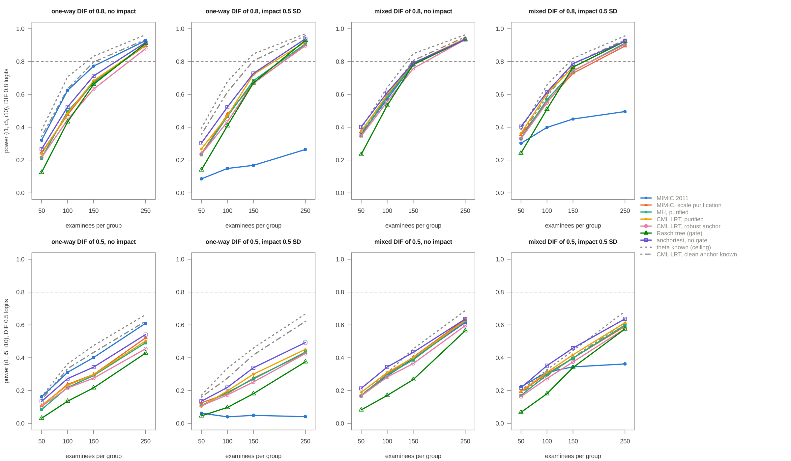
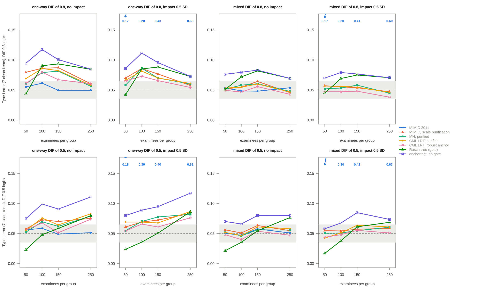

# The power study: testing the levers

**Status: done** (12,000 data sets, 2026-11-19). Planned in
[power.md §7](power.md#7-proposed-full-study); this document gives the design as run, the
methods, the hypotheses (fixed before the results), and the results (section 5).

## In short

1. **Sample size is the lever.** For 0.8 logits a test with a known clean anchor reaches .80 at
   150–160 per group; the realistic methods need about 160–195. For 0.5 logits, 250 per group
   gives .43–.63, and .80 needs about 380 (section 5.3).
2. **At 50 + 50 no method rescues the 2011 design.** The valid item tests have power .21–.25 against
   a clean-anchor ceiling of .34. At a true 5% level the 2011 difLRT has .22, the same as the
   correctly computed CML LRT (.22); the rest of its .32 came from false positives (sections 5.2,
   5.4).
3. **The 2011 MIMIC has the highest power only because it assumes no impact.** With the focal
   group 0.5 SD lower it flags 17%, 29%, 41% and 60% of clean items at 50, 100, 150 and 250 per
   group, exactly as the two-proportion math predicts (section 5.2).
4. **Purified CML LRT, purified Mantel–Haenszel and MIMIC with scale purification are
   interchangeable.** With mixed DIF they reach the clean-anchor ceiling at 5%. With one-way DIF
   they run at .05–.09 and lose .03–.15 of power to contamination.
5. **The robust anchor did not help (H1 rejected).** Its power is below the purified LRT's (by .03
   on average) and its Type I error still exceeds .065 in 8 one-way cells (section 5.5).
6. **What does raise power at a given n:** a one-sided test when the direction is fixed in advance
   (+.07 to +.12 at 50–150 per group), and the bundle test of the suspected items (.70 at 50 + 50,
   .95 at 100). Dropping the tree's gate adds .05–.14 on average but costs Type I control (section 5.6).

## 1. Why this study

[power.md](power.md) showed, from exact calculations and a pilot on the 2011 design, that
power at 50 + 50 is capped near .39 and that the three methods lose power or Type I control in
different ways. This study tests the proposed remedies where they matter: larger samples,
DIF in both directions, groups that differ in ability (impact), and a smaller DIF.

## 2. Design (as run)

| | |
|---|---|
| Items | 10 Rasch items, b = (−1, −1, −1, 0, 0, 0, 0, 1, 1, 1); DIF on i1, i5, i10 |
| Examinees per group | 50, 100, 150, 250 (equal groups) |
| DIF direction | **one-way**: all three easier for the focal group (the 2011 design); **mixed**: i1 and i10 easier, i5 harder |
| Impact | 0, or the focal group 0.5 SD lower: θ_R ~ N(0, 1), θ_F ~ N(−0.5, 1) |
| DIF size | 0.5 or 0.8 logits |
| No-DIF cells | each n × impact (8 cells): every flag is a false positive; they also give the size-adjusted critical values |
| Cells | 4 × 2 × 2 × 2 = 32, plus 8 = **40** |
| Replications | 300 per cell (12,000 data sets); 20 of them were the pilot (section 4) |
| Seeds | replication r of cell c: `set.seed(20261119 + 1000c + r)`; anchortest's tie-breaking: seed + 7 |

## 3. Methods (each run on every data set)

| Method | What it is | Why it is here |
|---|---|---|
| Benchmark: θ known | logistic regression of each item on group with θ as an offset | the ceiling |
| Benchmark: CML LRT, true clean anchor | the LRT below, told which items are clean | the ceiling for an anchor-based test |
| MIMIC as in 2011 | lavaan WLSMV, all ten direct effects, no `f1 ON x` | the 2011 method; valid only without impact |
| MIMIC with scale purification (M-SP) | `f1 ON x`; each item tested with the unflagged items as the anchor; flagged items' direct effects freed; repeated until the flagged set repeats (≤ 4 passes) (Wang, Shih & Yang, 2009) | the MIMIC remedy for impact and contamination |
| Mantel–Haenszel, purified | total-score matching, no continuity correction, standard purification | the efficient conditional test under the Rasch model |
| CML LRT, purified | conditional-ML likelihood ratio, the studied item split into reference and focal virtual items; standard purification | a correctly computed LRT |
| **CML LRT, robust anchor** (k = 5 or 3) | anchor = the k items whose group difference in CML difficulty is closest to the median difference (excluding the studied item) | lever 2 of power.md: an anchor that one-way DIF cannot drag |
| Rasch tree (gate) + anchortest | as in the rebuild | the 2011-rebuild third method |
| anchortest, no gate | forward/MTT anchor, Wald tests, without the tree's global test | lever 4c |
| difLRT as in 2011 | the lme4 rebuild of difR 6.1.0 (power.md §3.2); only in the 2011 design and its no-DIF twin (n = 50, no impact) | the 2011 reference; too slow for every cell |
| Bundle test | one common shift on i1, i5, i10 (pre-specified), the other 7 items as the anchor; GLS combination of the CML estimates | lever 4a |

**The robust anchor, in detail.** Fit the Rasch model by conditional ML in each group separately
and centre each group's difficulties at 0. Then $`d_i = \hat b_{iR} - \hat b_{iF}`$. Without DIF,
every d_i estimates the same constant (impact moves the centring, not the differences); a DIF
item's d_i is shifted by its DIF. The median of the d_i does not move as long as fewer than half
the items have DIF. For item j, the anchor is the k items (other than j) with the smallest
$`|d_i - \mathrm{median}(d)|`$, and item j is tested with the CML LRT against it. The anchor
is chosen from the same data, so its Type I error has to be checked (the no-DIF cells do that).

**Flag rules** (all statistics are saved; rules are applied afterwards):
- two-sided α = .05 (primary);
- one-sided α = .05 in the hypothesized direction (easier for the focal group), in the one-way and
  no-DIF cells only (lever 4b);
- Benjamini–Hochberg at .05 across the 10 items, with the false discovery rate (lever 5);
- size-adjusted power: the critical p-value at which the method flags 5% of items in the no-DIF
  cell with the same n and impact.

## 4. Hypotheses (from power.md, fixed before the results)

- **H1.** The robust-anchor CML LRT holds Type I error within .05 ± .015 in every cell, and its
  power is within .03 of the clean-anchor ceiling.
- **H2.** With one-way DIF, tests that use all other items as the anchor in their first pass
  (purified CML LRT, purified MH, M-SP) have Type I error above .05 that grows with n (the
  exact calculation for the unpurified test: .08, .12, .15, .22 at 50, 100, 150, 250 for 0.8
  logits). Purification removes most of the excess only at n ≥ 150. With mixed DIF the
  contamination largely cancels.
- **H3.** The 2011 MIMIC's Type I error is nominal without impact and near 1 with impact.
- **H4.** The bundle test reaches .80 at about 64 per group for 0.8 logits in the one-way cells,
  and holds .05 in the no-DIF cells.
- **H5.** With a valid anchor, power for 0.8 logits reaches .80 at 140–180 per group, and for 0.5
  logits stays below .80 even at 250 (it needs about 350).
- **H6.** The Rasch tree's gate costs power at every n, and the ungated anchortest's Type I error is
  above .05 under one-way DIF.

**The pilot** (20 replications per cell, the first 20 of the 300) checks that every method runs in
every cell and that the robust anchor is not grossly miscalibrated, and times a replication.
Section 5 reports it.

## 5. Results

### 5.0 Pilot (20 replications per cell)

All 800 data sets ran (27.6 minutes on 4 cores; 8.2 s per replication on average, most of it
MIMIC with scale purification, which needed 2.2 passes on average). No method failed and the
robust anchor never fell back to all other items. In the no-DIF cells the robust anchor's Type I
error was .03–.06 (k = 5) and .02–.035 (k = 3), and the 2011 MIMIC's was .04–.06 without impact
and .18–.57 with it, as H3 predicts. With 20 replications these are checks, not results; the
pilot's table is kept in `results/power_study/pilot/`. The full run reuses these 20 data sets as
its first 20 replications.

### 5.1 The run

All 12,000 data sets ran, with no failed fit in any method (`results/power_study/fit_problems.csv`):
no MIMIC or CML fit returned NA, the robust anchor never fell back to all other items, and M-SP
needed 2.2 passes on average. A replication took 8.2 s on average. The cloud machine running it
was reclaimed twice, so the run finished in three legs (the last took 127
minutes). Each replication has its own seed and its own file, and every file was checked readable
before each restart, so the results are those of an uninterrupted run.

Monte Carlo error: with 300 replications, a power of .5 for three items is estimated to about ±.03
(95%), and a Type I error of .05 over seven clean items to about ±.01. Differences of .02 or less
between methods are within noise.

Rates are the share of item tests flagged at two-sided α = .05: over i1, i5 and i10 for power,
over the seven clean items (all ten in the no-DIF cells) for Type I error. Values are given at
50 / 100 / 150 / 250 examinees per group. Everything is in `results/power_study/rates.csv`.

### 5.2 Type I error

**No DIF.** The rate at which each method flags items when no item has DIF:

| Method | No impact | Focal group 0.5 SD lower |
|---|---|---|
| Benchmark: θ known | .049 / .052 / .057 / .050 | .048 / .049 / .054 / .053 |
| CML LRT, all other items as anchor (= the clean anchor here) | .059 / .051 / .058 / .053 | .054 / .053 / .054 / .050 |
| MIMIC as in 2011 | .046 / .052 / .054 / .055 | **.169 / .291 / .416 / .603** |
| MIMIC, scale purification | .056 / .050 / .060 / .052 | .057 / .056 / .053 / .054 |
| MH, purified | .048 / .044 / .055 / .047 | .051 / .053 / .047 / .048 |
| CML LRT, purified | .055 / .046 / .054 / .048 | .050 / .050 / .051 / .049 |
| CML LRT, robust anchor (k = 5) | .046 / .041 / .052 / .043 | .039 / .041 / .044 / .035 |
| CML LRT, robust anchor (k = 3) | .031 / .028 / .038 / .031 | .029 / .030 / .033 / .027 |
| Rasch tree (gate) + anchortest | .012 / .010 / .015 / .011 | .009 / .014 / .009 / .011 |
| anchortest, no gate | .074 / .063 / .073 / .067 | .064 / .064 / .066 / .063 |
| difLRT as in 2011 | .089 (n = 50) | |
| Bundle test (rejection rate of the 1-df test) | .027 / .050 / .050 / .057 | .050 / .077 / .047 / .037 |

The 2011 MIMIC with impact is the two-proportion test of power.md §3.1. With no `f1 ON x`, each
direct effect absorbs the impact, so a clean item is flagged with the power of a two-proportion
test for the difference in proportion correct that the impact creates. That power, from the exact
marginal proportions, is .167, .287, .401 and .597 at 50, 100, 150 and 250 per group, against the
observed .169, .291, .416 and .603.

**One-way DIF, no impact** (the 2011 direction). Contamination adds false positives:

| Method | DIF 0.8 logits | DIF 0.5 logits |
|---|---|---|
| Exact: all-other anchor, *no* purification (power.md §5) | .083 / .118 / .153 / about .22 | |
| CML LRT, clean anchor known | .050 / .058 / .055 / .050 | .051 / .056 / .052 / .052 |
| MIMIC as in 2011 | .055 / .061 / .050 / .050 | .056 / .059 / .049 / .051 |
| MIMIC, scale purification | .080 / .086 / .087 / .060 | .058 / .073 / .070 / .075 |
| MH, purified | .060 / .079 / .081 / .056 | .052 / .070 / .062 / .079 |
| CML LRT, purified | .069 / .086 / .082 / .058 | .055 / .076 / .064 / .083 |
| CML LRT, robust anchor (k = 5) | .061 / .080 / .067 / .060 | .056 / .068 / .051 / .074 |
| CML LRT, robust anchor (k = 3) | .045 / .060 / .055 / .058 | .037 / .047 / .040 / .058 |
| Rasch tree (gate) + anchortest | .043 / .090 / .093 / .085 | .023 / .048 / .059 / .080 |
| anchortest, no gate | .095 / .117 / .101 / .085 | .075 / .099 / .091 / .111 |
| difLRT as in 2011 | .121 (n = 50) | |

Purification removes most of the exact excess, but not all, and how much depends on whether the
DIF items are caught. At 0.8 logits they are flagged about 90% of the time at 250 per group, leave
the anchor, and the Type I error returns to .06. At 0.5 logits they are flagged only half the time,
so the excess is still rising at 250 (.08). The impact cells look the same (.05–.09 for the three
purified tests). With **mixed DIF** the contamination cancels: the three purified tests stay
within .042–.064 in all 16 mixed cells.

### 5.3 Power

**DIF of 0.8 logits** (columns: DIF direction, impact):

| Method | One-way, no impact | One-way, impact | Mixed, no impact | Mixed, impact |
|---|---|---|---|---|
| Benchmark: θ known | .382 / .707 / .832 / .963 | .394 / .678 / .847 / .970 | .392 / .642 / .848 / .963 | .384 / .658 / .820 / .957 |
| Benchmark: CML LRT, clean anchor | .343 / .633 / .797 / .934 | .357 / .614 / .804 / .958 | .363 / .596 / .807 / .950 | .353 / .587 / .788 / .932 |
| MIMIC as in 2011 | .321 / .624 / .772 / .928 | .086 / .149 / .168 / .264 † | .359 / .571 / .783 / .937 | .302 / .399 / .450 / .496 † |
| MIMIC, scale purification | .246 / .476 / .676 / .898 | .238 / .478 / .667 / .901 | .376 / .593 / .788 / .939 | .352 / .553 / .729 / .894 |
| MH, purified | .213 / .496 / .670 / .902 | .233 / .466 / .683 / .908 | .348 / .587 / .780 / .937 | .333 / .568 / .742 / .912 |
| CML LRT, purified | .238 / .484 / .683 / .901 | .268 / .469 / .721 / .920 | .373 / .597 / .791 / .940 | .362 / .604 / .767 / .923 |
| CML LRT, robust anchor (k = 5) | .216 / .446 / .632 / .879 | .236 / .433 / .669 / .897 | .346 / .556 / .758 / .934 | .330 / .549 / .744 / .904 |
| CML LRT, robust anchor (k = 3) | .178 / .374 / .546 / .810 | .169 / .368 / .576 / .843 | .303 / .508 / .708 / .901 | .289 / .486 / .708 / .881 |
| Rasch tree (gate) + anchortest | .125 / .432 / .661 / .911 | .140 / .408 / .670 / .930 | .234 / .532 / .781 / .934 | .242 / .510 / .766 / .924 |
| anchortest, no gate | .267 / .524 / .713 / .916 | .303 / .523 / .728 / .939 | .402 / .611 / .791 / .934 | .404 / .614 / .787 / .924 |
| difLRT as in 2011 | .322 (n = 50) | | | |

**DIF of 0.5 logits:**

| Method | One-way, no impact | One-way, impact | Mixed, no impact | Mixed, impact |
|---|---|---|---|---|
| Benchmark: θ known | .162 / .362 / .474 / .662 | .172 / .336 / .459 / .667 | .188 / .308 / .453 / .687 | .202 / .327 / .443 / .682 |
| Benchmark: CML LRT, clean anchor | .143 / .333 / .432 / .622 | .160 / .276 / .417 / .621 | .173 / .297 / .397 / .623 | .187 / .288 / .401 / .613 |
| MIMIC as in 2011 | .162 / .311 / .401 / .610 | .062 / .040 / .049 / .041 † | .171 / .289 / .394 / .614 | .223 / .312 / .344 / .362 † |
| MIMIC, scale purification | .107 / .238 / .298 / .521 | .126 / .181 / .276 / .428 | .170 / .300 / .403 / .634 | .193 / .303 / .398 / .591 |
| MH, purified | .084 / .219 / .291 / .491 | .109 / .189 / .270 / .434 | .169 / .296 / .387 / .627 | .170 / .297 / .397 / .600 |
| CML LRT, purified | .110 / .232 / .297 / .502 | .103 / .198 / .300 / .451 | .189 / .310 / .400 / .626 | .197 / .311 / .418 / .613 |
| CML LRT, robust anchor (k = 5) | .103 / .216 / .276 / .454 | .108 / .173 / .252 / .426 | .167 / .282 / .364 / .596 | .163 / .273 / .374 / .577 |
| CML LRT, robust anchor (k = 3) | .079 / .174 / .206 / .374 | .082 / .141 / .201 / .361 | .142 / .238 / .307 / .550 | .119 / .233 / .329 / .528 |
| Rasch tree (gate) + anchortest | .032 / .135 / .217 / .428 | .046 / .097 / .181 / .375 | .082 / .170 / .267 / .564 | .067 / .181 / .340 / .575 |
| anchortest, no gate | .134 / .273 / .343 / .541 | .135 / .219 / .339 / .493 | .213 / .343 / .433 / .636 | .217 / .352 / .459 / .637 |

† Not a power: with impact the 2011 MIMIC's flags mix DIF with impact. With one-way DIF the two
cancel (the DIF makes the items easier for the lower-scoring focal group), so the DIF items are
rarely flagged while the clean items are flagged 17–63% of the time.

Three patterns. First, **with mixed DIF the purified tests are at the clean-anchor ceiling**: the
contamination cancels and purification has nothing to fix. Second, **with one-way DIF they lose
.03–.15** against the clean anchor. Third, **n dominates**. Fitting
the noncentrality as proportional to n (power.md §6, lever 1) to each method's four points gives
the n per group for .80 at 0.8 logits: 147–162 with the clean anchor, 157–193 for the purified CML
LRT, 161–193 for MH, 158–195 for M-SP. At 0.5 logits the clean anchor needs 375–392 per group.



*Figure 4. Power for i1, i5 and i10 by examinees per group. Top row 0.8 logits, bottom row 0.5.
Grey dotted: θ known; grey dot-dash: CML LRT with the clean anchor known; dashed line: .80.*



*Figure 5. Type I error on the seven clean items. The grey band is .035–.065 (the H1 criterion);
the 2011 MIMIC's values with impact are off the scale and printed at the top of the panel.*

### 5.4 Size-adjusted power

Size-adjusted power uses, for each method, the critical p-value at which it flags 5% of items in
the no-DIF cell with the same n and impact. In the 2011 design (one-way 0.8, no impact):

| Method | 50 / 100 / 150 / 250 |
|---|---|
| CML LRT, clean anchor known | .314 / .630 / .768 / .932 |
| MIMIC as in 2011 | .336 / .624 / .771 / .928 |
| MIMIC, scale purification | .226 / .478 / .656 / .891 |
| MH, purified | .217 / .504 / .658 / .902 |
| CML LRT, purified | .221 / .506 / .658 / .903 |
| CML LRT, robust anchor (k = 5) | .236 / .477 / .622 / .887 |
| CML LRT, robust anchor (k = 3) | .220 / .457 / .601 / .852 |
| anchortest, no gate | .204 / .467 / .632 / .896 |
| difLRT as in 2011 | .220 (n = 50) |

At a true 5% level the 2011 difLRT (.220) and the correctly computed CML LRT (.221) have the same
power; difLRT's raw .322 came from its Type I error of .12. The three purified tests are equal
within noise, and the 2011 MIMIC's lead is real only because this cell has no impact.

### 5.5 The robust anchor

The robust anchor (section 3) was meant to remove contamination without losing power. It did
neither well enough:

- **Type I error.** It is the most conservative of the anchor-based tests without DIF (.035–.052
  for k = 5), but under one-way DIF it ranges .051–.080 and lies above .065 in 8 of the 16
  one-way cells (.066–.080).
- **Power.** Within .03 of the clean-anchor ceiling in only 10 of 32 cells (mean gap .077); on
  average .030 below the purified CML LRT (range −.055 to +.005). Size-adjusted, it equals the
  purified test (mean difference −.008).
- **k = 3** is conservative (.027–.060) and loses more power (an anchor of three items is noisy).

Why, from `R/10_robust_anchor_check.R` (results in `results/power_study/robust_anchor_check.txt`):
with DIF of 0.5 logits at 250 per group the DIF items sit only about 2.5 standard errors from the
clean ones. The median of ten d_i is the mean of the 5th and 6th, which with seven clean items are
above the clean centre; it was pulled 0.10 logits toward the DIF items, and each DIF item entered
the anchor for a clean item in 25–30% of the replications. A normal approximation of the
selection alone (d_i independent, anchor = the five nearest the median) gives a Type I error of
about .06, as observed. The median protects against large DIF in few items; it does not remove
moderate DIF in 30% of a 10-item test. And a 5-item anchor estimates the impact less precisely
than the 7 or so items that purification keeps, which costs power.

### 5.6 Other flag rules and the bundle test

**One-sided tests** (DIF hypothesized to favour the focal group; one-way and no-DIF cells).
Power for 0.8 logits, no impact:

| Method | Two-sided | One-sided |
|---|---|---|
| CML LRT, clean anchor known | .343 / .633 / .797 / .934 | .458 / .746 / .870 / .968 |
| MIMIC, scale purification | .246 / .476 / .676 / .898 | .333 / .603 / .762 / .938 |
| MH, purified | .213 / .496 / .670 / .902 | .326 / .616 / .749 / .946 |
| CML LRT, purified | .238 / .484 / .683 / .901 | .343 / .607 / .757 / .939 |

The gain is .07–.12 at 50–150 per group. One-sided Type I error is .041–.057 for the purified
tests in the no-DIF cells, and .014–.041 under one-way DIF: contamination pushes the clean items
the *other* way, so a one-sided test in the hypothesized direction stays below .05. (The 2011
MIMIC's one-sided rule is likewise below .05 with impact, because impact also points the other
way; that does not make its two-sided flags valid.)

**Benjamini–Hochberg across the 10 items** controls the false discovery rate (.04–.12 for the
purified tests in the one-way cells, below .08 in the mixed cells) but costs power: for the
purified CML LRT at one-way 0.8, no impact, .103 / .296 / .506 / .823 against two-sided
.238 / .484 / .683 / .901. It is a guard against false flags, not a power lever. The 2011 MIMIC's
false discovery rate with impact is .14–.91.

**The bundle test** (one common shift on i1, i5 and i10, the other seven items as the anchor):

| Cell | 50 / 100 / 150 / 250 |
|---|---|
| One-way 0.8, no impact | .700 / .950 / 1.000 / 1.000 |
| One-way 0.8, impact | .710 / .947 / .993 / 1.000 |
| One-way 0.5, no impact | .283 / .630 / .790 / .910 |
| One-way 0.5, impact | .313 / .600 / .763 / .940 |
| No DIF (rejection rate), no impact / impact | .027 / .050 / .050 / .057 and .050 / .077 / .047 / .037 |

At 50 + 50 it detects the 2011 DIF 70% of the time (exact prediction .70), against .21–.25 for any
single valid item test. It answers "do these items, together, function differently?", not "which
one?". With mixed DIF the common shift is about a third of the DIF (+0.8, −0.8, +0.8), so the test
has little power there (.05–.38); it should be used only when the direction is shared and
pre-specified.

**The tree's gate** costs power at every n: anchortest without the gate finds .14, .12, .09 and
.05 more DIF items on average (at 50, 100, 150, 250). Without the gate, though, anchortest's Type I
error is above .05 everywhere: .063–.074 with no DIF, .058–.085 with mixed DIF and .075–.117 with
one-way DIF. Its anchor is selected from the same data and its Wald tests are liberal, so the
excess is not only contamination.

### 5.7 The hypotheses

| | Verdict | Evidence |
|---|---|---|
| H1. Robust anchor holds .05 ± .015 everywhere; power within .03 of the ceiling | **Rejected** | Type I .066–.080 in 8 of 16 one-way cells; power gap .077 on average (section 5.5) |
| H2. One-way DIF inflates the first-pass-anchor tests, growing with n; purification fixes most only at n ≥ 150; mixed DIF cancels | **Partly supported** | Inflation yes (.05–.09), mixed cancels yes (.042–.064). But purification already removes most of the exact excess at every n (.069 / .086 / .082 / .058 against .083 / .118 / .153 / .22 for 0.8 logits); the remainder peaks at 100–150 for 0.8 logits and is still growing at 250 for 0.5 |
| H3. 2011 MIMIC nominal without impact, near 1 with impact | **Supported in kind, wrong in size** | .046–.061 without impact; with impact .17 / .29 / .41 / .60, matching the two-proportion prediction (.17 / .29 / .40 / .60). "Near 1" was a misstatement of power.md §3.1's own math: it holds only for larger n |
| H4. Bundle reaches .80 at about 64 per group (0.8, one-way) and holds .05 | **Supported** | .70 at 50 and .95 at 100 (≈ .80 at 64); rejection rate .027–.077 with no DIF, mean .049 |
| H5. With a valid anchor, .80 at 140–180 per group for 0.8 logits; below .80 at 250 for 0.5 | **Supported** | Clean anchor: 147–162 per group; .61–.62 at 250 for 0.5 logits (about 380 needed, a little above the predicted 350) |
| H6. The gate costs power at every n; ungated anchortest is above .05 under one-way DIF | **Supported** | Gate cost .14 / .12 / .09 / .05; ungated Type I .075–.117 under one-way DIF (and .058–.085 elsewhere) |

### 5.8 What this means for the three methods

- **MIMIC.** The 2011 specification is valid only if the groups have equal means. In this design
  that makes it look the most powerful, but with an impact of 0.5 SD it flags most clean items at
  250 per group. MIMIC with `f1 ON x` and scale purification is the version to use: it holds 5%
  with mixed DIF and with impact, and its power equals the purified LRT's.
- **IRT-LR.** The 2011 difLRT's power advantage was its inflated Type I error (a conditional
  deviance treated as a likelihood ratio, plus contamination and accumulating purification). The
  CML LRT with standard purification, or Mantel–Haenszel without the continuity correction, gives
  the same size-adjusted power at a near-nominal level, in milliseconds.
- **Rasch tree.** The gate halves power at 50 + 50 and still costs .05 at 250. With a known binary
  grouping the tree adds nothing over the anchored item tests; it is for unknown or continuous
  covariates.
- **For any of them,** power of .80 per item needs about 160–195 per group for 0.8 logits and
  about 380 for 0.5. Below that, a pre-registered direction (one-sided test) and a pre-specified
  bundle are the honest ways to gain power.

## 6. Files

| Path | Contents |
|---|---|
| `R/power/study_methods.R` | signed CML LRT, purified CML LRT, robust-anchor CML LRT, bundle test, MIMIC 2011 and M-SP |
| `R/08_power_study.R` | the design and the run; one file per replication in `results/power/study_runs/` (not tracked) |
| `R/09_power_study_summary.R` | summaries → `results/power_study/`; figures `results/figures/fig4_study_power.png`, `fig5_study_type1.png` |
| `R/10_robust_anchor_check.R` | why the robust anchor exceeds .05 under one-way DIF (section 5.5) |
| `results/power_study/rates.csv` | every cell × method: power, Type I, one-sided, BH, FDR, critical p, size-adjusted power |
| `results/power_study/rates_mcse.csv` | `rates.csv` plus replication-level Monte Carlo SEs (`power_mcse`, `type1_mcse`), from `R/report_tables.R` |
| `results/power_study/item_rates.csv` | flag rates per item |
| `results/power_study/replications.rds` | every statistic and p-value (cell, rep, method, item; 1.1 million rows); design columns from `study_cells()` |
| `results/power_study/replications_info.csv` | per replication: seed, the tree's global p, M-SP passes, robust-anchor fallback, seconds |
| `results/power_study/fit_problems.csv` | failed fits and run times |
| `results/power_study/robust_anchor_check.txt` | output of `R/10_robust_anchor_check.R` |
| `results/power_study/sessionInfo.txt` | R and package versions of the run |
| `results/power_study/pilot/` | the pilot's tables (20 replications per cell) |

Reproduce from the repository root (about 7 hours on 4 cores; reruns skip finished replications):

```sh
Rscript R/08_power_study.R 4 300      # all 40 cells, 300 replications, 4 cores
Rscript R/09_power_study_summary.R
Rscript R/10_robust_anchor_check.R
```

To apply another flag rule without rerunning: `readRDS("results/power_study/replications.rds")`.
