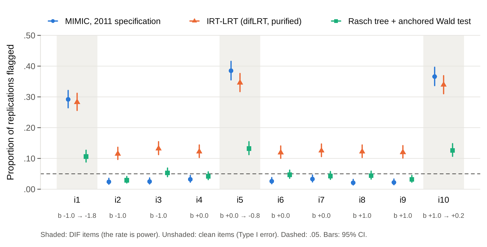
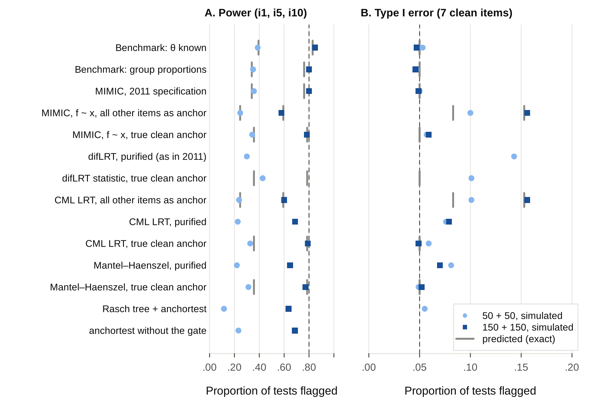
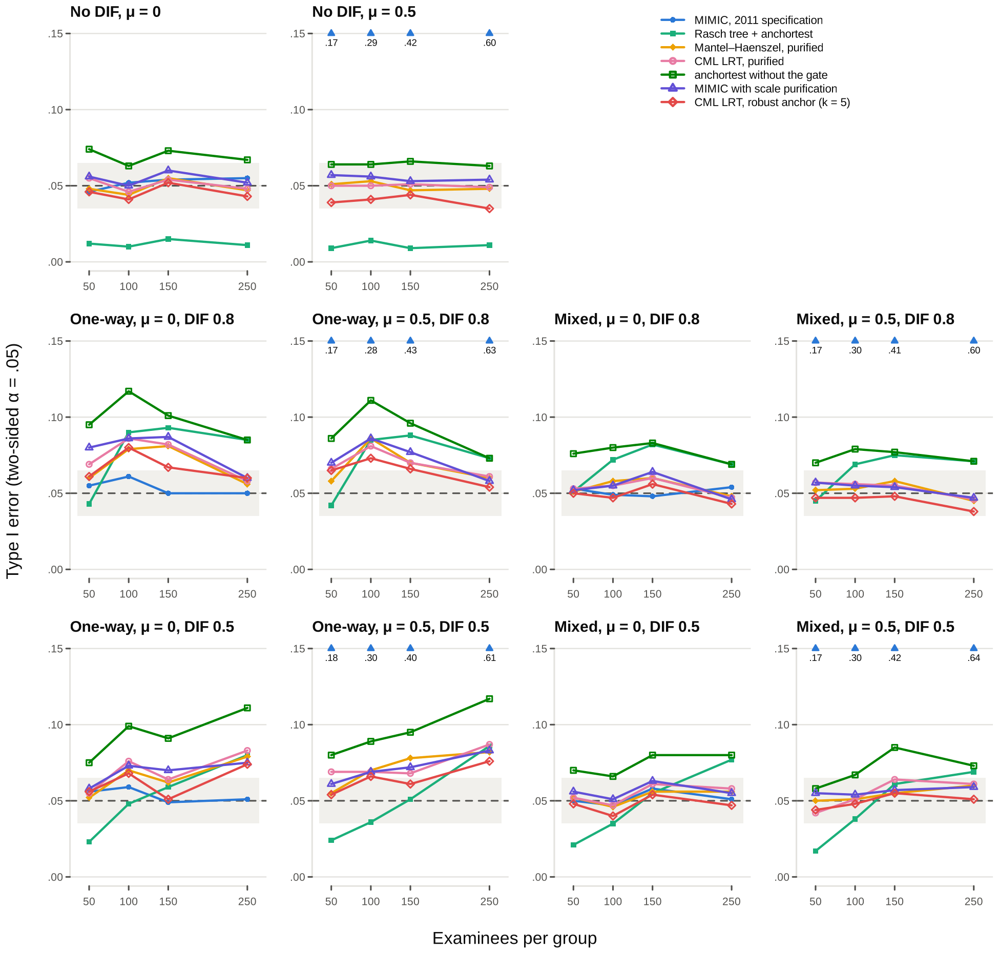

# Why item-level DIF tests have low power in small samples, and what it takes to raise it: MIMIC, IRT likelihood-ratio and Rasch-tree tests for binary items

[Qiu Wang](https://orcid.org/0000-0003-1635-8050) (Syracuse University) · Version 1.0.0 · November 2026 · DOI: assigned by Zenodo at release (see the repository README)

Text and figures: CC BY 4.0. Code: MIT. Code, results and how to reproduce every number: https://github.com/wangqiu-syr/dif-power-binary-items

## Abstract

Differential item functioning (DIF) tests are often run on small samples. I study three common
methods for binary items: the multiple-indicators multiple-causes (MIMIC) model, the IRT
likelihood-ratio test (LRT), and the Rasch tree. The design is typical of small applied studies:
10 Rasch items, 50 examinees per group, and 0.8 logits of DIF on 3 items.

Over 1,000 replications, MIMIC flagged a DIF item 34.8% of the time, the LRT 32.3% and the Rasch
tree 12.1%. The LRT also flagged 12.2% of clean items at a nominal 5%. Exact calculations over
all response patterns show that this is mainly a property of the design. A test that knew every
examinee's ability would reach only .39; any valid anchor-based test reaches about .36.

The LRT's extra power came from false positives. At a true 5% level it had the same power (.22)
as a correctly computed conditional-ML LRT. The Rasch tree loses power at its global gate. The
2011-style MIMIC is valid only when the groups have equal means.

A pre-specified simulation (40 conditions × 300 replications, hypotheses fixed in advance) then
tested the remedies. With a valid anchor, .80 power per item needs about 160–195 examinees per
group for 0.8 logits and about 380 for 0.5 logits. The purified conditional-ML LRT, purified
Mantel–Haenszel and MIMIC with scale purification are interchangeable and hold the 5% level.
At a fixed sample size, a one-sided test in a pre-registered direction (+.07 to +.12) and a joint
test of the suspected items (.70 at 50 + 50) raise power. A median-based robust anchor did not.
The study is reported in the ADEMP structure with Monte Carlo standard errors.

*Keywords:* differential item functioning, statistical power, MIMIC, likelihood-ratio test, Rasch
tree, Mantel–Haenszel, simulation study, small samples

## 1. Question

DIF analyses ask whether an item is easier for one group than another at the same level of the
trait. They are routine in test development and scale validation, and are often run on samples
of a few hundred examinees or fewer per group (Zwick, 2012; Scott et al., 2009). Three families
of methods are common for binary items: the MIMIC model (Finch, 2005; Woods, 2009), IRT
likelihood-ratio tests (Thissen et al., 1988; Magis et al., 2010), and, more recently,
model-based recursive partitioning in the form of the Rasch tree (Strobl et al., 2015).

This report starts from a small simulation of these three methods that found low power
everywhere. That design (10 items, 50 examinees per group, three DIF items of 0.8 logits) is a
typical small-sample design. It was first run in 2011 and is rebuilt here in R; the rebuild is
documented separately (`docs/rebuild.md`). The report asks three questions:

1. How much power do the three methods have in this design?
2. Why is it low: the design, or the methods?
3. What designs and methods give .80 power per item while holding the 5% level?

Following Siepe et al. (2024), both simulations are described in the ADEMP structure: aims,
data-generating mechanisms, estimands, methods and performance measures (Morris et al., 2019).
Monte Carlo standard errors (MCSEs) are reported with every rate.

## 2. Three DIF methods in brief

**Table 1**

*The Three Methods as Implemented*

| | MIMIC | IRT likelihood-ratio test | Rasch tree |
|---|---|---|---|
| Model | One-factor model for binary indicators with a direct effect of group on each item (probit; WLSMV) | Rasch model fitted with and without a group-specific difficulty for the studied item | Rasch model, recursively split on covariates by a parameter-instability test |
| Anchor | 2011 specification: all ten direct effects free and no effect of group on the factor (identified by equal means) | All other items, purified iteratively (`difR::difLRT`, `purify = TRUE`) | Chosen after a split by `anchortest()` (forward selection, mean test-statistic threshold) |
| Item test | z for the direct effect, flag if z ≥ 1.96 (one-sided) | Likelihood-ratio χ²(1) at α = .05 | Wald test of the item's difficulty difference, α = .05 |
| Software | lavaan (Rosseel, 2012); Mplus 4.2 in 2011 | difR (Magis et al., 2010), via lme4 | psychotree, psychotools (Strobl et al., 2015; Kopf et al., 2015a, 2015b) |

**MIMIC.** The group indicator enters the measurement model as a covariate. A direct effect of
group on an item, over and above its effect through the factor, is uniform DIF. Without the
factor's regression on group, the 2011 specification identifies the model by assuming equal
group means.

**IRT likelihood-ratio test.** Each item is tested by comparing a model that constrains its
difficulty to be equal across groups with one that frees it, using the other items as the
anchor. Purification removes flagged items from the anchor and re-tests.

**Rasch tree.** A global score test asks whether the item parameters are stable across the
values of a covariate (here, group). If they are not, the sample is split, and anchored Wald
tests within the split identify the items. With a known binary grouping, the tree's first step
is a global DIF test, which acts as a gate for the item tests.

## 3. Simulation 1: the small-sample design

**Table 2**

*ADEMP Summary of Simulation 1*

| Element | Simulation 1 |
|---|---|
| Aims | Estimate power and Type I error of the three methods in a typical small-sample design |
| Data-generating mechanism | Rasch model, 10 items, b = (−1, −1, −1, 0, 0, 0, 0, 1, 1, 1); 50 reference and 50 focal examinees, θ ~ N(0, 1) in both groups; uniform DIF of 0.8 logits on i1, i5 and i10, all easier for the focal group; 1,000 replications |
| Estimands and targets | For each item, the null hypothesis of no DIF (δ_j = 0) |
| Methods | The three methods of Table 1, applied to the same data sets |
| Performance measures | Power: share of tests on i1, i5, i10 that flag. Type I error: share of tests on the seven clean items that flag. 95% CIs with the replication as the unit |

The 1,000 replications ran as 8 parallel jobs of 125, with seeds 101–108. Each data set depends
only on the seed and the replication number. lavaan's MIMIC estimates matched the 2011 Mplus 4.2
output to within 0.001 on the 2011 data file (`results/mimic_lavaan_vs_mplus42.csv`).

**Table 3**

*Power and Type I Error in Simulation 1 (1,000 Replications)*

| Method | Power (3 DIF items) | Type I error (7 clean items) |
|---|---|---|
| MIMIC (z >= 1.96) | .348 [.329, .366] | .026 [.022, .030] |
| IRT-LRT (difLRT, purified) | .323 [.305, .340] | .122 [.114, .130] |
| Rasch tree + anchored Wald | .121 [.106, .137] | .041 [.035, .048] |

*Note.* 95% confidence intervals in brackets. The nominal level is .025 for the one-sided MIMIC
rule and .05 for the other two methods.

**Figure 1**

*Power and Type I Error of the Three Methods in Simulation 1 (1,000 Replications)*

*Note.* Bars: 95% confidence intervals, with the replication as the unit. MIMIC uses the 2011
one-sided rule (nominal .025); the dashed line marks .05.

**Figure 2**

*Flag Rate of Each Item, by Method, in Simulation 1*

*Note.* Shaded items have DIF (the rate is power); the others are clean (the rate is Type I
error). Bars: Wilson 95% confidence intervals.

All three methods have low power. MIMIC and the LRT have similar power, but the LRT flags 12% of
clean items, more than twice its nominal 5%, and does so equally on all seven. The Rasch tree
controls Type I error but finds a DIF item only 12% of the time: its global test splits on group
in only 29% of replications.

## 4. Why power is low

### 4.1 The ceiling for any valid test

Write the DIF model as logit P(Y_ij = 1 | θ_i) = θ_i − b_j + δ_j x_i. If every examinee's θ were
known, each would contribute P(1 − P) of information about δ_j. Averaged over θ ~ N(0, 1), that
information is about .207 at b = 0 and .178 at b = ±1. Then

Var(δ̂_j) = 1/(n_R I(b_jR)) + 1/(n_F I(b_jF)),  z_j = δ_j / √Var(δ̂_j),  power = Φ(z_j − 1.96) + Φ(−z_j − 1.96).

For i5 at 50 + 50 this gives z = 1.77 and power .43. Table 4 computes the same quantities exactly
for each item, over all 1,024 response patterns integrated over θ.

**Table 4**

*Exact Power at 50 + 50 and the Sample Size Needed for .80*

| | θ known | Item's own proportions (= 2011 MIMIC) | Clean anchor | All other items as anchor |
|---|---|---|---|---|
| Power at 50 + 50, mean of i1, i5, i10 | .39 | .34 | .36 | .25 |
| Type I error, mean of the 7 clean items | .05 | .05 | .05 | .08 |
| n per group for .80 (range over i1, i5, i10) | 125–165 | 151–193 | 142–181 | 221–297 |

*Note.* "Item's own proportions" is the two-proportion test that the 2011 MIMIC reduces to
(Section 4.2). "All other items as anchor" is the unpurified anchor that difLRT starts from.
Files: `results/power/exact_items.csv`, `exact_n_for_power.csv`. The code for the exact
calculations is released with the follow-up study (Section 6).

So no method can do much better than about .35 at 50 + 50. A small focal group cannot be offset
by a large reference group, because the focal term in Var(δ̂) does not shrink: with 50 focal
examinees, even a test that knew θ is capped at .69 for i5.

### 4.2 MIMIC (2011 specification): a two-proportion test

With all ten direct effects free and no regression of the factor on group, the mean structure
is saturated. Each item's threshold and direct effect reproduce its two group proportions, and
the z for the direct effect is in effect the two-proportion test of p_jF against p_jR. This
predicts power of .30, .37 and .36 for i1, i5 and i10; observed: .29, .39 and .37.

Its Type I error is correct here only because the groups' means are truly equal. With a mean
difference μ, every direct effect absorbs about λ_j μ, and clean items are flagged with the power
of that two-proportion difference (Section 5).

### 4.3 The IRT likelihood-ratio test: power bought with false positives

Three sources inflate difLRT's Type I error:
1. **The statistic is not a likelihood ratio.** difR fits the Rasch model as a generalized linear
   mixed model and takes the difference of the deviances, which for such a model are conditional
   deviances. With no DIF at all the statistic averages 1.17–1.26 instead of 1
   (`results/power/lrt_calibration.csv`).
2. **Contamination.** With all other items as the anchor, three one-way DIF items make the focal
   group look 0.23 logits more able. Each clean item then appears to have −0.26 logits of DIF,
   and each DIF item shrinks to about 0.63. The bias is fixed while the standard errors shrink, so
   the exact false-positive rate rises with n: .08, .12, .15, .19 and .26 at 50, 100, 150, 200
   and 300 per group.
3. **Purification only accumulates flags.** difR drops flagged items and does not re-test them,
   so a clean item flagged in any round stays flagged.

At a true 5% level (size-adjusted against the no-DIF condition, Section 5), difLRT's power is
.220, the same as a correctly computed conditional-ML (CML) LRT (.221).

### 4.4 The Rasch tree: two gates

The tree's global test spends its noncentrality on 9 degrees of freedom while the DIF sits in
3 items. Asymptotically it splits with probability P(χ²₉(6.15) > 16.92) = .35 (observed .29); the
same noncentrality in a 1-df test would give .70. Given a split, `anchortest()` finds a DIF item
42% of the time, so overall .29 × .42 = .12. With a known binary grouping the gate only costs
power.

### 4.5 The levers, and a pilot

**Table 5**

*Levers to Raise Power, with Their Predicted Effects*

| Lever | Math | Predicted gain |
|---|---|---|
| 1. More examinees | Noncentrality is proportional to n | .80 at 140–180 per group (0.8 logits); about 350 (0.5 logits) |
| 2. A valid anchor | Estimate impact by the median of the item-wise group differences, not the mean (robust scaling; Halpin, 2024) | Type I back to .05; power .25 → .36 |
| 3. A correctly computed LRT | Conditional-ML log-likelihoods (Andersen, 1973); purification that re-tests every item; Mantel–Haenszel (Holland & Thayer, 1988) without the continuity correction | Removes two of the three sources of excess Type I error |
| 4a. Test the suspected items together | One common shift on i1, i5, i10: z_bundle ≈ z_item √3 | .70 at 50 + 50; .80 at about 64 per group |
| 4b. Test in the hypothesized direction | One-sided: Φ(z − 1.645) | i5: .51 instead of .38 |
| 4c. No gate when the groups are known | anchortest without the tree's global test | About twice the tree's power |
| 5. The right error rate for the job | False discovery rate across the 10 items (Benjamini & Hochberg, 1995) | Fewer false flags, little power lost |

A pilot on the 50 + 50 design (100 replications) and at 150 per group (200 replications) agreed
with these predictions to within Monte Carlo error: the largest difference was .04 (Figure 3;
`docs/power.md` §5). The exception is the difLRT statistic, which flags 10% of clean items even
with a clean anchor (Section 4.3).

**Figure 3**

*Pilot: Simulated Against Predicted Power and Type I Error*

*Note.* Points: simulated rates at 50 and 150 examinees per group (difLRT was run at 50 only).
Grey bars: predicted values from the exact calculations (`results/power/exact_*.csv`); at 150 per
group the θ-known and group-proportion predictions scale the exact 50 + 50 z by √3. Dashed lines:
.80 (power) and .05 (Type I error).

## 5. Simulation 2: the pre-specified power study

**Table 6**

*ADEMP Summary of Simulation 2*

| Element | Simulation 2 |
|---|---|
| Aims | Test the levers of Table 5 where they matter: larger samples, DIF in both directions, groups that differ in ability (impact), a smaller DIF. Six hypotheses fixed before the results (below) |
| Data-generating mechanism | As Simulation 1, but n per group {50, 100, 150, 250} × DIF size {0.5, 0.8} × direction {one-way: i1, i5, i10 easier for the focal group; mixed: i1, i10 easier, i5 harder} × impact {θ_F ~ N(0, 1) or N(−0.5, 1)}, plus 8 no-DIF conditions (each n × impact): 40 conditions × 300 replications (12,000 data sets). Seed for replication r of condition c: 20261119 + 1000c + r |
| Estimands and targets | For each item, the null hypothesis δ_j = 0 |
| Methods | Benchmarks: θ known (logistic regression with θ as offset); CML LRT with the true clean anchor. 2011 MIMIC; MIMIC with the factor regressed on group and scale purification (M-SP; Wang et al., 2009); Mantel–Haenszel (Holland & Thayer, 1988), purified, without continuity correction; CML LRT (Andersen, 1973), purified; CML LRT with a median-based robust anchor (k = 5, 3); Rasch tree + anchortest; anchortest without the gate; difLRT as in 2011 (n = 50, no impact only); a bundle test of i1 + i5 + i10 |
| Performance measures | Power and Type I error as in Simulation 1 (rates pooled over replications); size-adjusted power (critical value from the no-DIF condition with the same n and impact); one-sided power; Benjamini–Hochberg false discovery rate; fit failures. MCSEs with the replication as the cluster |
| Hypotheses | H1: the robust anchor holds .05 ± .015 everywhere, with power within .03 of the clean-anchor ceiling. H2: one-way DIF inflates tests whose first-pass anchor is all other items, growing with n; purification removes most of the excess only at n ≥ 150; mixed DIF cancels. H3: the 2011 MIMIC is nominal without impact and near 1 with it. H4: the bundle test reaches .80 at about 64 per group (0.8, one-way) and holds .05. H5: with a valid anchor, .80 at 140–180 per group for 0.8 logits, and below .80 at 250 for 0.5 logits. H6: the tree's gate costs power at every n, and the ungated anchortest exceeds .05 under one-way DIF |

**Timeline.** H1–H5 were written in `docs/power.md` §7 and committed before any power-study data
were generated (commit `e2ae5a1`, 2026-11-19 00:32 UTC). The design, the methods and H6 were
committed with the 20-replication pilot and before the full run (`4b26331`, 01:06 UTC). The
results followed (`29dc42a`, 09:33 UTC). The hypotheses were fixed in version control, not
registered in a public registry. The commits are in the author's development repository, which is
not public; Supplement A3 reproduces the hypotheses as committed, the retrospective ADEMP-PreReg
form (Siepe et al., 2024) and all deviations. H6 was added, and H2, H4 and H5 were extended, in
the same commit as the 20-replication pilot's results, so they may have been informed by the pilot
(Supplement A3, §6.4).

**Deviations from the plan** (details in Supplement A3):
1. 300 replications per condition instead of 500, decided from the pilot's timing before the full
   run (`4b26331`).
2. difLRT was run only in the two n = 50, no-impact conditions (planned: at 50 per group), because
   it was too slow to run everywhere.
3. The bundle test used the seven other items as its anchor instead of a purified anchor, and was
   run in every condition, not only the one-way ones (specified at `4b26331`).
4. The bias of the DIF estimates, listed as an outcome at `e2ae5a1`, was not estimated: the
   estimates were not saved. It is part of the follow-up study.

The robust-anchor diagnostic in Section 5.3 was written during the run and is exploratory.

**Execution.** All 12,000 data sets ran, with no failed fit in any method. M-SP needed 2.2
purification passes on average. A replication took 8.2 s on average. R 4.3.3 on Linux; versions
in `results/power_study/sessionInfo.txt`.

**Monte Carlo error.** Rates are pooled over replications (flags divided by tests). Their MCSEs
treat each replication as a cluster, since items in the same data set are correlated
(`results/power_study/rates_mcse.csv`). Recomputed from the stored statistics, the rates
reproduce `results/power_study/rates.csv` to within .002. Across all 40 conditions for the nine
methods in Tables 7 and 8, the largest MCSE is .014 for Type I error (.012 in the no-DIF
conditions) and .024 for power. Differences of .03 or less between methods in one
condition are therefore within noise.

### 5.1 Type I error

**Table 7**

*Type I Error (Two-Sided α = .05), at 50 / 100 / 150 / 250 Examinees per Group*

| Method | No DIF, μ = 0 | No DIF, μ = 0.5 | One-way 0.8, μ = 0 | One-way 0.8, μ = 0.5 | Mixed 0.8, μ = 0.5 |
|---|---|---|---|---|---|
| Benchmark: θ known | .049 / .052 / .057 / .050 | .048 / .049 / .054 / .053 | .050 / .054 / .057 / .053 | .044 / .055 / .046 / .045 | .047 / .051 / .052 / .048 |
| Benchmark: CML LRT, true clean anchor | .059 / .051 / .058 / .053 | .054 / .053 / .054 / .050 | .050 / .058 / .055 / .050 | .056 / .057 / .051 / .050 | .051 / .049 / .048 / .049 |
| MIMIC, 2011 specification | .046 / .052 / .054 / .055 | .169 / .291 / .416 / .603 | .055 / .061 / .050 / .050 | .172 / .282 / .429 / .631 | .171 / .297 / .407 / .596 |
| MIMIC with scale purification (M-SP) | .056 / .050 / .060 / .052 | .057 / .056 / .053 / .054 | .080 / .086 / .087 / .060 | .070 / .086 / .077 / .058 | .057 / .055 / .054 / .047 |
| Mantel–Haenszel, purified | .048 / .044 / .055 / .047 | .051 / .053 / .047 / .048 | .060 / .079 / .081 / .056 | .058 / .086 / .070 / .060 | .052 / .053 / .058 / .045 |
| CML LRT, purified | .055 / .046 / .054 / .048 | .050 / .050 / .051 / .049 | .069 / .086 / .082 / .058 | .066 / .081 / .070 / .061 | .057 / .056 / .055 / .046 |
| CML LRT, robust anchor (k = 5) | .046 / .041 / .052 / .043 | .039 / .041 / .044 / .035 | .061 / .080 / .067 / .060 | .065 / .073 / .066 / .054 | .047 / .047 / .048 / .038 |
| Rasch tree + anchortest | .012 / .010 / .015 / .011 | .009 / .014 / .009 / .011 | .043 / .090 / .093 / .085 | .042 / .085 / .088 / .073 | .045 / .069 / .075 / .071 |
| anchortest without the tree's gate | .074 / .063 / .073 / .067 | .064 / .064 / .066 / .063 | .095 / .117 / .101 / .085 | .086 / .111 / .096 / .073 | .070 / .079 / .077 / .071 |

*Note.* μ = impact: the focal group's mean is 0.5 SD lower. Clean items: all ten in the no-DIF
conditions; seven otherwise.

**Figure 4**

*Type I Error by Condition and Method in Simulation 2*

*Note.* μ: impact (the focal group's mean is 0.5 SD lower when μ = 0.5). Shaded band: .035–.065
(the H1 criterion). Triangles at the top: off-scale values of the 2011 MIMIC with impact, printed
below them. Exact values for every condition: `results/power_study/rates_mcse.csv`.

- **The 2011 MIMIC is valid only without impact.** With the focal group 0.5 SD lower, it flags
  17%, 29%, 41% and 60% of clean items at 50, 100, 150 and 250 per group. The two-proportion
  prediction is .17, .29, .40 and .60 (H3: partly supported; the inflation is as predicted, but it
  does not come near 1 in the range studied).
- **The purified tests are close to nominal.** Purified CML LRT, purified MH and M-SP hold .05
  without DIF, with or without impact, and with mixed DIF, where contamination cancels
  (.042–.064). With one-way DIF they run at .05–.09. Purification removes most of the exact
  unpurified excess (.083 / .118 / .153 / .22 for 0.8 logits). What remains peaks at 100–150 per
  group for 0.8 logits and is still growing at 250 for 0.5 logits (H2: partly supported).
- **The Rasch tree is conservative without DIF** (.009–.015), because its gate rarely opens. Once
  DIF opens it, its item tests run at .04–.09. Without the gate, anchortest exceeds .05 everywhere
  (.063–.074 with no DIF, .075–.117 with one-way DIF; H6).

### 5.2 Power and the sample size needed

**Table 8**

*Power (Two-Sided α = .05), at 50 / 100 / 150 / 250 Examinees per Group*

| Method | One-way 0.8, μ = 0 | One-way 0.8, μ = 0.5 | Mixed 0.8, μ = 0.5 | One-way 0.5, μ = 0 | Mixed 0.5, μ = 0.5 |
|---|---|---|---|---|---|
| Benchmark: θ known | .382 / .707 / .832 / .963 | .394 / .678 / .847 / .970 | .384 / .658 / .820 / .957 | .162 / .362 / .474 / .662 | .202 / .327 / .443 / .682 |
| Benchmark: CML LRT, true clean anchor | .343 / .633 / .797 / .934 | .357 / .614 / .804 / .958 | .353 / .587 / .788 / .932 | .143 / .333 / .432 / .622 | .187 / .288 / .401 / .613 |
| MIMIC, 2011 specification | .321 / .624 / .772 / .928 | .086 / .149 / .168 / .264 | .302 / .399 / .450 / .496 | .162 / .311 / .401 / .610 | .223 / .312 / .344 / .362 |
| MIMIC with scale purification (M-SP) | .246 / .476 / .676 / .898 | .238 / .478 / .667 / .901 | .352 / .553 / .729 / .894 | .107 / .238 / .298 / .521 | .193 / .303 / .398 / .591 |
| Mantel–Haenszel, purified | .213 / .496 / .670 / .902 | .233 / .466 / .683 / .908 | .333 / .568 / .742 / .912 | .084 / .219 / .291 / .491 | .170 / .297 / .397 / .600 |
| CML LRT, purified | .238 / .484 / .683 / .901 | .268 / .469 / .721 / .920 | .362 / .604 / .767 / .923 | .110 / .232 / .297 / .502 | .197 / .311 / .418 / .613 |
| CML LRT, robust anchor (k = 5) | .216 / .446 / .632 / .879 | .236 / .433 / .669 / .897 | .330 / .549 / .744 / .904 | .103 / .216 / .276 / .454 | .163 / .273 / .374 / .577 |
| Rasch tree + anchortest | .125 / .432 / .661 / .911 | .140 / .408 / .670 / .930 | .242 / .510 / .766 / .924 | .032 / .135 / .217 / .428 | .067 / .181 / .340 / .575 |
| anchortest without the tree's gate | .267 / .524 / .713 / .916 | .303 / .523 / .728 / .939 | .404 / .614 / .787 / .924 | .134 / .273 / .343 / .541 | .217 / .352 / .459 / .637 |

**Figure 5**

*Power by Sample Size, DIF Size and Direction in Simulation 2*

*Note.* Grey lines: the two benchmarks (θ known; CML LRT with the true clean anchor). Dashed
line: .80.

- **Sample size is the lever.** For 0.8 logits, the clean-anchor benchmark reaches .80 at
  147–162 per group. The realistic methods need about 160–195 (H5: supported).
- **0.5 logits is a different study.** Even the clean-anchor benchmark reaches only .61–.62 at 250
  per group; .80 needs about 380 (H5).
- **The purified tests are interchangeable.** Purified CML LRT, purified MH and M-SP are within
  noise of each other in every condition. With mixed DIF they reach the clean-anchor ceiling.
  With one-way DIF they lose .03–.15 of power to contamination.
- **The 2011 MIMIC's lead is an artefact.** It has the highest raw power at μ = 0 only because it
  assumes no impact; at μ = 0.5 its power for one-way DIF collapses (.09–.26), because impact and
  DIF push in opposite directions.

### 5.3 Levers at a fixed sample size

**Table 9**

*Levers at 50 + 50 (and Beyond), One-Way DIF of 0.8 Logits, No Impact*

| Lever | Result |
|---|---|
| Size-adjusted power at 50 + 50 (true 5% level) | CML LRT with clean anchor .314; 2011 MIMIC .336; M-SP .226; MH .217; CML LRT purified .221; robust anchor (k = 5) .236; anchortest .204; difLRT .220 |
| One-sided test (pre-registered direction), purified CML LRT | .343 / .607 / .757 / .939 against two-sided .238 / .484 / .683 / .901: a gain of .07–.12 at 50–150 per group. One-sided Type I error .041–.057 without DIF, .014–.041 under one-way DIF |
| Bundle test of i1 + i5 + i10 (pre-specified) | .700 / .950 / 1.000 / 1.000 (exact prediction at 50 + 50: .70). Rejection rate without DIF .027–.077 (mean .049). Little power with mixed DIF (.05–.38) |
| Robust anchor (k = 5) | Type I error above .065 in 8 of 16 one-way conditions (.066–.080); power on average .030 below the purified CML LRT and .077 below the clean-anchor ceiling (H1 rejected) |
| Dropping the tree's gate | +.14 / +.12 / +.09 / +.05 more DIF items found, at the cost of Type I error above .05 |
| Benjamini–Hochberg across the 10 items | False discovery rate .04–.12 under one-way DIF, but power .103 / .296 / .506 / .823 for the purified CML LRT: a guard against false flags, not a power lever |

*Note.* Values at 50 / 100 / 150 / 250 per group unless stated. Source: `docs/power_study.md` §5.4–5.6.

**Why the robust anchor failed.** With 0.5 logits of DIF the DIF items sit only about 2.5
standard errors from the clean ones. The median of ten item-wise differences is pulled about 0.10
logits toward the DIF items, and each DIF item enters the anchor for a clean item in 25–30% of
replications (`results/power_study/robust_anchor_check.txt`). The median protects against large
DIF in a few items; it does not remove moderate DIF in 30% of a 10-item test. A five-item anchor
also estimates impact less precisely than the seven or so items that purification keeps.

### 5.4 The hypotheses

**Table 10**

*Decisions on the Pre-Specified Hypotheses*

| Hypothesis | Decision | Evidence |
|---|---|---|
| H1. Robust anchor holds .05 ± .015; power within .03 of the ceiling | Rejected | Type I .066–.080 in 8 of 16 one-way conditions; mean power gap .077 |
| H2. One-way DIF inflates first-pass-anchor tests, growing with n; purification removes most of it only at n ≥ 150; mixed DIF cancels | Partly supported | Inflation .05–.09; mixed cancels (.042–.064); but purification already removes most of the excess at every n |
| H3. 2011 MIMIC nominal without impact, near 1 with impact | Partly supported | .046–.061 without impact; .17 / .29 / .41 / .60 with impact, as the two-proportion test predicts, but not near 1 |
| H4. Bundle test .80 at about 64 per group; holds .05 | Supported | .70 at 50 and .95 at 100; rejection rate .027–.077 without DIF |
| H5. Valid anchor: .80 at 140–180 per group (0.8 logits); below .80 at 250 (0.5 logits) | Supported | Clean anchor 147–162 per group; .61–.62 at 250 for 0.5 logits |
| H6. The gate costs power at every n; ungated anchortest above .05 under one-way DIF | Supported | Gate cost .14 / .12 / .09 / .05; ungated Type I .075–.117 |

## 6. Discussion and recommendations

The low power of the small-sample design is mostly a property of the design. At 50 examinees per
group, three items with 0.8 logits of DIF cannot be detected reliably by any valid item-level
test: the exact ceiling is .39 with θ known and about .36 with a clean anchor. The methods differ
in how much of that ceiling they lose and in whether they hold their level.

- **The LRT's apparent power is not power.** Its excess came from a statistic that is not a
  likelihood ratio, from contamination of the anchor, and from purification that accumulates
  flags. A correctly computed CML LRT, or Mantel–Haenszel without the continuity correction,
  gives the same size-adjusted power at a near-nominal level.
- **The 2011 MIMIC is valid only with equal group means.** With the factor regressed on group and
  scale purification, MIMIC behaves like the purified LRT.
- **The Rasch tree is the wrong tool for a known binary grouping.** It is built for unknown or
  continuous covariates, where its search is the point (Strobl et al., 2015).

**Table 11**

*Recommendations for Item-Level DIF Studies with Binary Items*

| | Recommendation |
|---|---|
| 1 | Compute the power ceiling before collecting data. For a known θ it takes one formula (Section 4.1); for a clean anchor, an exact calculation over all response patterns (code released with the follow-up study) |
| 2 | Plan the sample per group, especially the focal group: about 160–195 per group for .80 per item at 0.8 logits, about 380 at 0.5 logits (10 items, three with DIF) |
| 3 | Do not use MIMIC without the factor's regression on group when the groups may differ in ability; use scale purification |
| 4 | Use a correctly computed LRT (CML) or Mantel–Haenszel without the continuity correction, with purification that re-tests every item |
| 5 | Below the needed n, gain power honestly: a one-sided test in a pre-registered direction, or a pre-specified test of the suspected items together |
| 6 | Report DIF tests with their Type I error under the conditions of the study (impact, direction of DIF); size-adjusted power is the fair comparison between methods |
| 7 | In simulation studies of DIF methods, report MCSEs, fit failures and the full design (ADEMP), and fix hypotheses before the results (Siepe et al., 2024) |

**Two further questions** follow from the results; a follow-up study, registered on OSF
(https://osf.io/35nvh/), takes them up:
- *Why does anchortest flag clean items without any DIF?* Its anchor is chosen from the same data
  and its Wald tests are liberal.
- *Can any data-driven anchor beat purification?* It depends on how far the DIF items sit from
  the clean ones in standard-error units (δ/s).

**Limitations.** The data come from the Rasch model, with uniform DIF only, 10 items, equal group
sizes and two impact levels. Unequal groups and items that differ in discrimination are common in
practice; they are the subject of the follow-up study. Each condition's rates carry Monte Carlo error of up to
about .03 for power; differences smaller than that are not interpreted.

## 7. Conclusions

Small item-level DIF studies with binary items are underpowered by design, not by method: at 50
examinees per group no valid test can do much better than about .35 against 0.8 logits of DIF.
The methods that seemed to do better did so by giving up the 5% level. With a valid anchor, .80
power per item needs about 160–195 examinees per group for 0.8 logits and about 380 for 0.5. Below
that, a pre-registered direction or a pre-specified joint test is the honest way to gain power.

## Data and code availability

Code, results and this report: https://github.com/wangqiu-syr/dif-power-binary-items (version
1.0.0), archived on Zenodo (DOI in the README). `R/run_all.R` rebuilds every table and figure from
the stored results in a few minutes, or reruns both simulations. All results come from simulated
data; no external data are used. Two parts are not included: the code for the exact calculations
(Section 4.1, Table 4), which is released with the follow-up study (its results are included), and
the 2011 materials, which are described in `docs/rebuild.md`.

## AI assistance

Code, analyses and drafts of this report were developed with Claude (Anthropic) as a coding and
writing assistant, under the author's direction. The author designed the study, checked the
results and is responsible for the content.

## References

Andersen, E. B. (1973). A goodness of fit test for the Rasch model. *Psychometrika, 38*(1), 123–140. https://doi.org/10.1007/BF02291180

Benjamini, Y., & Hochberg, Y. (1995). Controlling the false discovery rate: A practical and powerful approach to multiple testing. *Journal of the Royal Statistical Society: Series B (Methodological), 57*(1), 289–300. https://doi.org/10.1111/j.2517-6161.1995.tb02031.x

Finch, H. (2005). The MIMIC model as a method for detecting DIF: Comparison with Mantel–Haenszel, SIBTEST, and the IRT likelihood ratio. *Applied Psychological Measurement, 29*(4), 278–295. https://doi.org/10.1177/0146621605275728

Halpin, P. F. (2024). Differential item functioning via robust scaling. *Psychometrika, 89*(3), 796–821. https://doi.org/10.1007/s11336-024-09957-6

Holland, P. W., & Thayer, D. T. (1988). Differential item performance and the Mantel–Haenszel procedure. In H. Wainer & H. I. Braun (Eds.), *Test validity* (pp. 129–145). Erlbaum.

Kopf, J., Zeileis, A., & Strobl, C. (2015a). Anchor selection strategies for DIF analysis: Review, assessment, and new approaches. *Educational and Psychological Measurement, 75*(1), 22–56. https://doi.org/10.1177/0013164414529792

Kopf, J., Zeileis, A., & Strobl, C. (2015b). A framework for anchor methods and an iterative forward approach for DIF detection. *Applied Psychological Measurement, 39*(2), 83–103. https://doi.org/10.1177/0146621614544195

Magis, D., Béland, S., Tuerlinckx, F., & De Boeck, P. (2010). A general framework and an R package for the detection of dichotomous differential item functioning. *Behavior Research Methods, 42*(3), 847–862. https://doi.org/10.3758/BRM.42.3.847

Morris, T. P., White, I. R., & Crowther, M. J. (2019). Using simulation studies to evaluate statistical methods. *Statistics in Medicine, 38*(11), 2074–2102. https://doi.org/10.1002/sim.8086

Rosseel, Y. (2012). lavaan: An R package for structural equation modeling. *Journal of Statistical Software, 48*(2), 1–36. https://doi.org/10.18637/jss.v048.i02

Scott, N. W., Fayers, P. M., Aaronson, N. K., Bottomley, A., de Graeff, A., Groenvold, M., Gundy, C., Koller, M., Petersen, M. A., & Sprangers, M. A. G. (2009). A simulation study provided sample size guidance for differential item functioning (DIF) studies using short scales. *Journal of Clinical Epidemiology, 62*(3), 288–295. https://doi.org/10.1016/j.jclinepi.2008.06.003

Siepe, B. S., Bartoš, F., Morris, T. P., Boulesteix, A.-L., Heck, D. W., & Pawel, S. (2024). Simulation studies for methodological research in psychology: A standardized template for planning, preregistration, and reporting. *Psychological Methods.* https://doi.org/10.1037/met0000695

Strobl, C., Kopf, J., & Zeileis, A. (2015). Rasch trees: A new method for detecting differential item functioning in the Rasch model. *Psychometrika, 80*(2), 289–316. https://doi.org/10.1007/s11336-013-9388-3

Thissen, D., Steinberg, L., & Wainer, H. (1988). Use of item response theory in the study of group differences in trace lines. In H. Wainer & H. I. Braun (Eds.), *Test validity* (pp. 147–169). Erlbaum.

Wang, W.-C., Shih, C.-L., & Yang, C.-C. (2009). The MIMIC method with scale purification for detecting differential item functioning. *Educational and Psychological Measurement, 69*(5), 713–731. https://doi.org/10.1177/0013164409332228

Woods, C. M. (2009). Evaluation of MIMIC-model methods for DIF testing with comparison to two-group analysis. *Multivariate Behavioral Research, 44*(1), 1–27. https://doi.org/10.1080/00273170802620121

Zwick, R. (2012). *A review of ETS differential item functioning assessment procedures: Flagging rules, minimum sample size requirements, and criterion refinement* (ETS Research Report No. RR-12-08). Educational Testing Service. https://doi.org/10.1002/j.2333-8504.2012.tb02290.x

## Appendix

**A1. Full results.** All 40 conditions × methods, with MCSEs: `results/power_study/rates_mcse.csv`
(columns `power`, `type1` and the other flag rules from `results/power_study/rates.csv`;
`power_mcse`, `type1_mcse` computed by `R/report_tables.R`). Every statistic of every replication:
`results/power_study/replications.rds`.

**A2. Monte Carlo standard errors.** A rate is the pooled ratio of flags to tests over the
replications of a condition, R = Σf_r / Σt_r, where replication r has f_r flags among t_r tests.
Items in one data set are correlated, so the MCSE treats the replication as the cluster (a ratio
estimator): MCSE = √(Var(f_r − R t_r) / n_rep) / mean(t_r). The bundle test gives one test per
replication, so its MCSE is binomial. Simulation 1 reports 95% confidence intervals computed the
same way, with the replication as the unit.

**A3. Retrospective ADEMP-PreReg form for Simulation 2.** `report/supplement_A3.pdf` (source
`report/supplement_A3.md`): the template of Siepe et al. (2024), completed after the study from the
three commits that fixed the plan, with the hypotheses as committed and every deviation.
