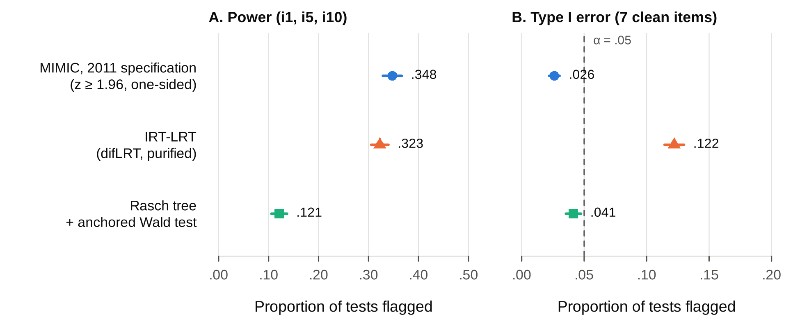
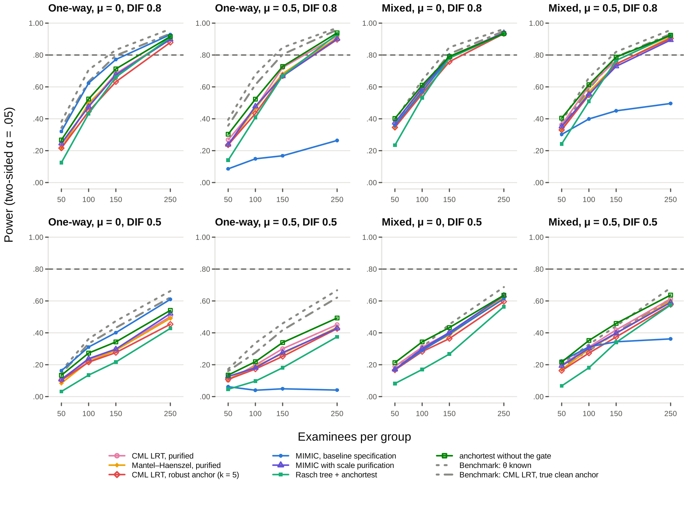

# A wider window, the same wall: Two decades of item-level DIF tests for binary items

[Qiu Wang](https://orcid.org/0000-0003-1635-8050) (Syracuse University) · Version 1.0.0 · November 2026 · DOI: assigned by Zenodo at release (see the repository README)

Text and figures: CC BY 4.0. Code: MIT. Code, results and how to reproduce every number: https://github.com/wangqiu-syr/dif-power-binary-items

## Abstract

Item-level tests of differential item functioning (DIF) are often run on small samples, and they
often find little. This report asks which design factors and which parts of a DIF method decide
the power and the Type I error of these tests for binary items, and what it takes to reach .80
power per item while holding the 5% level.

A baseline design at the small-sample end of DIF studies (10 Rasch items, 50 examinees per group,
0.8 logits of DIF on three items) gave low power for all three common methods: .35 for MIMIC, .32
for the IRT likelihood-ratio test (which also flagged 12% of clean items) and .12 for the Rasch
tree. Exact calculations showed that no valid test
can exceed the ceiling of .39. The three methods differ in four components at once (the test
statistic, the anchor, the design, meaning how group differences in ability are handled, and the
decision rule), so the baseline comparison cannot say which component costs power or inflates
Type I error.

We therefore built a family around each baseline method (LRT, MIMIC and Rasch tree), with variants
that each change one or two components: nine methods in three families, including an LRT that is
told which items are clean, plus a test that knows every examinee's ability as a ceiling. The
pre-specified Simulation 2 tested them: 40 conditions crossing sample size (50 to
250 per group), DIF size, DIF direction and group ability differences, 300 replications each, with
six hypotheses fixed in advance. Sample size is the main lever for power: for 0.8 logits, .80 per
item needs about 160–195 examinees per group with a purified anchor (about 150–160 with a known clean
anchor); for 0.5 logits, even a known clean anchor needs about 380. At a fixed sample size, a one-sided test in a pre-registered direction (+.07 to +.12) and a joint test
of the suspected items (.70 at 50 per group) raise power; a median-based robust anchor did not.
Type I error is held by a correctly computed statistic, by purification that re-tests every item
and, for MIMIC, by modeling the group difference in ability. The purified conditional-ML
likelihood-ratio test, purified Mantel–Haenszel and MIMIC with scale purification were
interchangeable and close to .05, whereas the baseline MIMIC flagged 17–60% of clean items when
the groups differed by 0.5 SD. The Rasch tree had the lowest power in small samples because its
global test acts as a gate: its item tests run only after a 9-df test of all items rejects, which
happened in 29% of the baseline samples. Without the gate, anchortest found .05–.14 more DIF items
at 50–250 per group but exceeded the 5% level (.06–.12), so with a known binary grouping the tree
adds nothing over direct item tests; it is built for unknown or continuous covariates. The study is
reported in the ADEMP structure with Monte Carlo standard errors.

*Keywords:* differential item functioning, statistical power, MIMIC, likelihood-ratio test, Rasch
tree, Mantel–Haenszel, simulation study, small samples

## 1. Question

DIF analyses ask whether an item is easier for one group than another at the same level of the
trait. They are routine in test development and scale validation, and are often run on samples
of a few hundred examinees or fewer per group (Zwick, 2012; Scott et al., 2009). Three families
of methods are common for binary items: the MIMIC model (Finch, 2005; Woods, 2009), IRT
likelihood-ratio tests (Thissen et al., 1988; Magis et al., 2010), and
model-based recursive partitioning in the form of the Rasch tree (Strobl et al., 2015). The
comparisons behind these methods span two decades, from Finch's (2005) comparison of MIMIC with
Mantel–Haenszel and the IRT likelihood ratio to an anchor based on robust scaling (Halpin, 2024).

The starting point is a **baseline design** at the small-sample end of DIF studies: 10 Rasch
items, 50 examinees per group, and three items with 0.8 logits of DIF. Its setting draws on the simulation study of Vaughn and Wang
(2010). A simulation of the three
methods in this design found low power for all of them. The baseline study was first run 
with Mplus and difR; it is rebuilt here in R, and the rebuild is documented separately
(`docs/rebuild.md`). The report asks three questions:

1. How much power do the three methods have in the baseline design, and is the low power a
   property of the design or of the methods?
2. Which design factors and which method components raise power, and which hold the Type I error
   at its nominal level?
3. What designs and methods give .80 power per item while holding the 5% level?

Section 2 describes an item-level DIF test as four components. Sections 3 and 4 answer the first
question with a simulation of the baseline design (Simulation 1) and exact calculations, and turn
each method's losses into a list of factors (Section 4.5). Section 5 tests these factors in a
pre-specified simulation (Simulation 2), with nine methods in three families, chosen so that
comparisons between them isolate one component at a time. Following Siepe et al. (2024), both simulations are described in the ADEMP structure: aims,
data-generating mechanisms, estimands, methods and performance measures (Morris et al., 2019).
Monte Carlo standard errors (MCSEs) are reported with every rate.

## 2. Three DIF methods and four components

Every item-level DIF test has four components:
1. a **statistic** that measures the group difference on the studied item;
2. an **anchor**: the items assumed free of DIF, which put the two groups on a common scale;
3. a **design**: how the method represents the two groups, in particular a difference between
   their mean trait levels (impact);
4. a **decision rule**: the α level, one- or two-sided, any preliminary test, and any adjustment
   across items.

Table 1 shows how the three baseline methods set each component.

**Table 1**

*The Three Baseline Methods, by Component*

| Component | MIMIC (baseline specification) | IRT likelihood-ratio test (difLRT) | Rasch tree |
|---|---|---|---|
| Statistic | $z$ for the direct effect of group on the item, in a one-factor model for binary indicators (probit; WLSMV) | Deviance difference between Rasch models with and without a group-specific difficulty for the item, fitted as a mixed model | Wald $z$ for the item's difficulty difference, after a split |
| Anchor | None explicit: all ten direct effects are free | All other items, purified iteratively (`purify = TRUE`): flagged items are dropped and never re-tested | Chosen after the split by `anchortest()` (forward selection, mean test-statistic threshold) |
| Design | Impact assumed zero: no effect of group on the factor (the model is identified by equal group means) | Impact estimated: a group main effect in the mixed model | Impact absorbed by the anchor, which fixes the common scale |
| Decision rule | One-sided, $z \ge 1.96$ ($\alpha = .025$) | $\chi^2_1 \ge 3.84$ ($\alpha = .05$) | Item tests only if a global test of all item parameters (9 df) rejects at .05; then Wald $p < .05$ |
| Software | lavaan (Rosseel, 2012); Mplus 4.2 in the original study | difR (Magis et al., 2010), via lme4 | psychotree, psychotools (Strobl et al., 2015; Kopf et al., 2015a, 2015b) |

**MIMIC.** The group indicator enters the measurement model as a covariate. A direct effect of
group on an item, over and above its effect through the factor, is uniform DIF. Without the
factor's regression on group, the baseline specification identifies the model by assuming equal
group means.

**IRT likelihood-ratio test.** Each item is tested by comparing a model that constrains its
difficulty to be equal across groups with one that frees it, using the other items as the
anchor. Purification removes flagged items from the anchor and re-tests.

**Rasch tree.** A global score test asks whether the item parameters are stable across the
values of a covariate (here, group). If they are not, the sample is split, and anchored Wald
tests within the split identify the items. With a known binary grouping, the tree's first step
is a global DIF test, which acts as a gate for the item tests.

The three methods differ in all four components at once. A difference between them in
Simulation 1 therefore cannot be traced to one component. Simulation 2 varies the components
separately (Section 5.1).

## 3. Simulation 1: the baseline design

**Table 2**

*ADEMP Summary of Simulation 1*

| Element | Simulation 1 |
|---|---|
| Aims | Estimate power and Type I error of the three methods in the baseline design |
| Data-generating mechanism | Rasch model, 10 items, $b = (-1, -1, -1, 0, 0, 0, 0, 1, 1, 1)$; 50 reference and 50 focal examinees, $\theta \sim N(0, 1)$ in both groups; uniform DIF of 0.8 logits on i1, i5 and i10, all easier for the focal group; 1,000 replications. Setting after Vaughn and Wang (2010) |
| Estimands and targets | For each item, the null hypothesis of no DIF, $\delta_j = 0$ |
| Methods | The three methods of Table 1, applied to the same data sets |
| Performance measures | Power: share of tests on i1, i5, i10 that flag. Type I error: share of tests on the seven clean items that flag. 95% CIs with the replication as the unit |

The 1,000 replications ran as 8 parallel jobs of 125, with seeds 101–108. Each data set depends
only on the seed and the replication number. lavaan's MIMIC estimates matched the original Mplus
4.2 output to within 0.001 on the original data file (`results/mimic_lavaan_vs_mplus42.csv`).

**Table 3**

*Power and Type I Error in Simulation 1 (1,000 Replications)*

| Method | Power (3 DIF items) | Type I error (7 clean items) |
|---|---|---|
| MIMIC, baseline specification (z ≥ 1.96, one-sided) | .348 [.329, .366] | .026 [.022, .030] |
| IRT-LRT (difLRT, purified) | .323 [.305, .340] | .122 [.114, .130] |
| Rasch tree + anchored Wald test | .121 [.106, .137] | .041 [.035, .048] |

*Note.* 95% confidence intervals in brackets. The nominal level is .025 for the one-sided MIMIC
rule and .05 for the other two methods.

**Figure 1**

*Power and Type I Error of the Three Methods in Simulation 1 (1,000 Replications)*

*Note.* Bars: 95% confidence intervals, with the replication as the unit. MIMIC uses the one-sided
rule of the baseline study (nominal .025); the dashed line marks .05.

**Figure 2**

*Flag Rate of Each Item, by Method, in Simulation 1*

*Note.* Shaded items have DIF (the rate is power); the others are clean (the rate is Type I
error). Bars: Wilson 95% confidence intervals.

All three methods have low power. MIMIC and the LRT have similar power, but the LRT flags 12% of
clean items, more than twice its nominal 5%, and does so equally on all seven. The Rasch tree
controls Type I error but finds a DIF item only 12% of the time: its global test splits on group
in only 29% of replications.

## 4. Why power is low

### 4.1 The ceiling for any valid test

Write the DIF model as $$\mathrm{logit}\, P(Y_{ij} = 1 \mid \theta_i) = \theta_i - b_j + \delta_j x_i,$$
where $x_i = 1$ for the focal group. If every examinee's $\theta$ were known, each would contribute
$P(1 - P)$ of information about $\delta_j$. Averaged over $\theta \sim N(0, 1)$, that information
is about .207 at $b = 0$ and .178 at $b = \pm 1$. Then $$\text{power} = \Phi(z_j - 1.96) + \Phi(-z_j - 1.96),$$ as $$z_j = \frac{\delta_j}{\sqrt{\mathrm{Var}(\hat\delta_j)}}, \quad\text{with}\quad \mathrm{Var}(\hat\delta_j) = \frac{1}{n_R\, I(b_{jR})} + \frac{1}{n_F\, I(b_{jF})}.$$

For i5 at 50 + 50 this gives $z = 1.77$ and power .43. Table 4 computes the same quantities
exactly for each item, over all 1,024 response patterns integrated over $\theta$.

**Table 4**

*Exact Power at 50 + 50 and the Sample Size Needed for .80*

| | θ known | Item's own proportions (= baseline MIMIC) | Clean anchor | All other items as anchor |
|---|---|---|---|---|
| Power at 50 + 50, mean of i1, i5, i10 | .39 | .34 | .36 | .25 |
| Type I error, mean of the 7 clean items | .05 | .05 | .05 | .08 |
| n per group for .80 (range over i1, i5, i10) | 125–165 | 151–193 | 142–181 | 221–297 |

*Note.* "Item's own proportions" is the two-proportion test that the baseline MIMIC reduces to
(Section 4.2). "All other items as anchor" is the unpurified anchor that difLRT starts from.
Files: `results/power/exact_items.csv`, `exact_n_for_power.csv`. The code for the exact
calculations is released with the follow-up study (Section 6).

So no method that has to estimate θ can do much better than about .35 at 50 + 50 (.34–.36), and
none can exceed .39. A small focal group cannot be offset
by a large reference group, because the focal term in $\mathrm{Var}(\hat\delta_j)$ does not
shrink: with 50 focal examinees, even a test that knew $\theta$ is capped at .69 for i5.

Each method then loses part of this ceiling, or buys power with false positives, through one of
its components (Sections 4.2–4.4).

### 4.2 MIMIC (baseline specification): a two-proportion test

*Component: design.* With all ten direct effects free and no regression of the factor on group,
the mean structure is saturated. Each item's threshold and direct effect reproduce its two group
proportions, and the $z$ for the direct effect is in effect the two-proportion test of $p_{jF}$
against $p_{jR}$. This predicts power of .30, .37 and .36 for i1, i5 and i10; observed: .29, .39
and .37.

Its Type I error is correct here only because the groups' means are truly equal. With a mean
difference $\mu$, every direct effect absorbs about $\lambda_j \mu$, and clean items are flagged
with the power of that two-proportion difference (Section 5).

### 4.3 The IRT likelihood-ratio test: power bought with false positives

Three sources inflate difLRT's Type I error, one in the statistic and two in the anchor:
1. **The statistic is not a likelihood ratio.** difR fits the Rasch model as a generalized linear
   mixed model and takes the difference of the deviances, which for such a model are conditional
   deviances. With no DIF at all the statistic averages 1.17–1.26 instead of 1
   (`results/power/lrt_calibration.csv`).
2. **Contamination of the anchor.** With all other items as the anchor, three one-way DIF items
   make the focal group look 0.23 logits more able. Each clean item then appears to have −0.26
   logits of DIF, and each DIF item shrinks to about 0.63. The bias is fixed while the standard
   errors shrink, so the exact false-positive rate rises with $n$: .08, .12, .15, .19 and .26 at
   50, 100, 150, 200 and 300 per group.
3. **Purification only accumulates flags.** difR drops flagged items and does not re-test them,
   so a clean item flagged in any round stays flagged.

At a true 5% level (size-adjusted against the no-DIF condition, Section 5), difLRT's power is
.220, the same as a correctly computed conditional-ML (CML) LRT (.221).

### 4.4 The Rasch tree: two gates

*Component: decision rule.* The tree's global test spends its noncentrality on 9 degrees of
freedom while the DIF sits in 3 items. Asymptotically it splits with probability
$P(\chi^2_9(6.15) > 16.92) = .35$ (observed .29); the same noncentrality in a 1-df test would give
.70. Given a split, `anchortest()` finds a DIF item 42% of the time, so overall
$.29 \times .42 = .12$. With a known binary grouping the gate only costs power.

### 4.5 Factors that raise power and factors that control Type I error

Sections 4.1–4.4 point to factors in each of the four components of Table 1. Some belong to the
study design: the analyst chooses the sample size per group (especially the focal group), but not
the size of the DIF, its direction across items or the impact, which a method can only model. The
others are choices of anchor, statistic and decision rule. Table 5 sorts the factors by what they
do (Panel A raises power, Panel B holds the Type I error) and, within each panel, by component:
design, anchor, statistic-based and decision-based. Each factor has a predicted effect from the
calculations above and a comparison in Simulation 2 that tests it. The hypotheses H1–H6 named in
the last column are stated in Section 5.1 (Table 6).

**Table 5**

*Factors That Raise Power and Factors That Control Type I Error, With Their Predicted Effects*

| Factor | Mechanism | Predicted effect | Tested in Simulation 2 by |
|---|---|---|---|
| **A. Raising power** | | | |
| *Design* | | | |
| A1. More examinees, especially in the focal group | The noncentrality grows with $n$; the focal term in $\mathrm{Var}(\hat\delta_j)$ does not shrink when only the reference group grows | .80 at 140–180 per group for 0.8 logits; about 350 for 0.5 logits | $n$ = 50, 100, 150, 250 (H5) |
| *Anchor* | | | |
| A2. A valid anchor | One-way DIF in an all-other-items anchor shrinks each DIF item's apparent DIF from 0.8 to about 0.63 | .25 → .36 at 50 + 50 | The clean-anchor benchmark against the purified tests; the robust anchor (H1, H2) |
| *Statistic-based* | | | |
| A3. An efficient statistic | Conditional tests (CML LRT, Mantel–Haenszel) use the Rasch model's sufficient statistic; Mantel–Haenszel's continuity correction costs power | Mantel–Haenszel without the correction: Type I .055 instead of .027 without DIF, power .21 instead of .16 at 50 + 50 (pilot) | Size-adjusted power of every method |
| A4. A joint test of the suspected items | One common shift on i1, i5 and i10: $z_{\text{bundle}}$ approaches $z_{\text{item}} \sqrt{3}$ (less, because the three items share the anchor's error) | .70 at 50 + 50; .80 at about 64 per group | The bundle test (H4) |
| *Decision-based* | | | |
| A5. A one-sided test in a pre-registered direction | $\Phi(z - 1.645)$ instead of $\Phi(z - 1.96)$ | i5: .51 instead of .38 | The one-sided rule, applied to every method |
| A6. No global gate when the groups are known | The 9-df global test dilutes the DIF of 3 items | About twice the tree's power, at some cost in Type I error (B5) | anchortest without the gate (H6) |
| **B. Controlling Type I error** | | | |
| *Design* | | | |
| B1. A Type I error that does not grow with $n$ | A fixed bias (anchor contamination, unmodelled impact) grows relative to the shrinking standard error; a valid test stays at α at any $n$ | All-other-items anchor, one-way 0.8 logits: .08, .12, .15, .22 at 50–250 per group | Every method at $n$ = 50–250 (H2, H3) |
| B2. Modeling impact | Without a group effect on the factor, each direct effect absorbs about $\lambda_j \mu$ | Type I error grows with $\mu$ and $n$ | The baseline MIMIC against M-SP, at $\mu$ = 0 and 0.5 (H3) |
| *Anchor* | | | |
| B3. Purification that re-tests every item | Re-testing lets clean items leave the flagged set; removing the DIF items from the anchor removes the contamination bias | Removes most of the excess in B1, at least at $n \ge 150$ | Purified CML LRT, Mantel–Haenszel and M-SP against difLRT; the robust anchor (H1, H2) |
| *Statistic-based* | | | |
| B4. A correctly computed statistic | difR's deviance difference is not a likelihood ratio | No DIF, 50 + 50: .063–.080 → .050 (calibration check) | CML LRT and Mantel–Haenszel against difLRT |
| *Decision-based* | | | |
| B5. A preliminary global test (the gate) | Item tests run only when a global test rejects; without DIF it rejects in about 5% of samples | Type I error far below .05 without DIF, at the cost of power (A6) | The gated tree against anchortest (H6) |
| B6. Error control across items | Benjamini–Hochberg across the 10 items (Benjamini & Hochberg, 1995) | Fewer false flags; some power lost | The Benjamini–Hochberg rule, applied to every method |

*Note.* Predicted effects are for the baseline design (10 items, 50 + 50, 0.8 logits, one-way DIF,
no impact) unless stated. Conditional-ML: Andersen (1973); Mantel–Haenszel: Holland and Thayer
(1988); the robust anchor follows the robust-scaling idea of Halpin (2024).

Before Simulation 2, a pilot checked these predictions on the baseline design (100 replications)
and at 150 per group (200 replications). It ran fourteen methods, the rows of Figure 3: two
benchmarks (θ known, and the two-proportion test on the item's own group proportions) and, for
each baseline method, variants that change one component at a time. For MIMIC: the baseline
specification, then a group effect on the factor (f ~ x) with all other items or with the truly
clean items as the anchor. For the likelihood-ratio test: difLRT; difLRT's statistic with the
true clean anchor; and the CML LRT with all other items as the anchor, purified, or with the true
clean anchor. For Mantel–Haenszel (MH; without the continuity correction): purified and with the true
clean anchor. For the Rasch tree: with and without its gate. Where an exact prediction exists
(grey bars), the simulated rates agreed with it to within Monte Carlo error; the largest
difference was .04 (`docs/power.md` §5). The exception is difLRT's statistic, which flags 10% of
clean items even with a clean anchor (Section 4.3). Simulation 2 keeps the variants that isolate
one factor each (Section 5.1).

**Figure 3**

*Pilot: Simulated Against Predicted Power and Type I Error for Fourteen Methods*

*Note.* Points: simulated rates at 50 and 150 examinees per group (difLRT was run at 50 only).
Grey bars: predicted values from the exact calculations (`results/power/exact_*.csv`); at 150 per
group the θ-known and group-proportion predictions scale the exact 50 + 50 $z$ by $\sqrt{3}$.
Dashed lines: .80 (power) and .05 (Type I error).

## 5. Simulation 2: a pre-specified study of the factors

### 5.1 Design: from three methods to nine

Simulation 1 compared three complete procedures. Because they differ in all four components
(Table 1), it could show that power was low but not which component lost it. Simulation 2
therefore turns each baseline method into a family: the baseline version as the reference, and
variants that change as few of its components as possible. Table 6 summarizes the design in the
ADEMP structure: 40 conditions crossing sample size, DIF size, DIF direction and impact; the
methods; the performance measures; and the six hypotheses, H1–H6, fixed before the results.

**Table 6**

*ADEMP Summary of Simulation 2*

| Element | Simulation 2 |
|---|---|
| Aims | Test the factors of Table 5 where they matter: larger samples, DIF in both directions, groups that differ in ability (impact), a smaller DIF. Six hypotheses fixed before the results (below) |
| Data-generating mechanism | As Simulation 1, but $n$ per group $\in \{50, 100, 150, 250\}$ × DIF size $\in \{0.5, 0.8\}$ × direction {one-way: i1, i5, i10 easier for the focal group; mixed: i1, i10 easier, i5 harder} × impact {$\theta_F \sim N(0, 1)$ or $N(-0.5, 1)$}, plus 8 no-DIF conditions (each $n$ × impact): 40 conditions × 300 replications (12,000 data sets). Seed for replication $r$ of condition $c$: $20261119 + 1000c + r$ |
| Estimands and targets | For each item, the null hypothesis $\delta_j = 0$ |
| Methods | Nine methods in three families (Table 7). LRT: difLRT (baseline; two conditions), purified CML LRT, purified Mantel–Haenszel, CML LRT with a robust anchor ($k$ = 5), and the CML LRT with the true clean anchor (benchmark). MIMIC: baseline specification; scale purification. Rasch tree: tree + anchortest (baseline); anchortest without the gate. Also the θ-known benchmark, a robust anchor with $k$ = 3, and a bundle test of i1 + i5 + i10 |
| Performance measures | Power and Type I error as in Simulation 1 (rates pooled over replications); size-adjusted power (critical value from the no-DIF condition with the same $n$ and impact); one-sided power; Benjamini–Hochberg false discovery rate; fit failures. MCSEs with the replication as the cluster |
| Hypotheses | H1: the robust anchor holds .05 ± .015 everywhere, with power within .03 of the clean-anchor ceiling. H2: one-way DIF inflates tests whose first-pass anchor is all other items, growing with $n$; purification removes most of the excess only at $n \ge 150$; mixed DIF cancels. H3: the baseline MIMIC is nominal without impact and near 1 with it. H4: the bundle test reaches .80 at about 64 per group (0.8, one-way) and holds .05. H5: with a valid anchor, .80 at 140–180 per group for 0.8 logits, and below .80 at 250 for 0.5 logits. H6: the tree's gate costs power at every $n$, and the ungated anchortest exceeds .05 under one-way DIF |

Table 7 lists the nine methods by
family (LRT, MIMIC, Rasch tree), with the θ-known benchmark first. Comparing a variant with its
reference, or with a benchmark, isolates one factor of Table 5.

- **Two benchmarks bound what is possible** in each condition. The θ-known test is the ceiling set
  by the design alone (sample size, DIF size). The CML LRT that is told which items are clean, in
  the LRT family, is the ceiling for any anchor-based test. The gap between a method and the
  clean-anchor benchmark is that method's own loss; the gap between the two benchmarks is the cost
  of not knowing $\theta$.
- **The method factors are varied within families.** In the LRT family, the CML LRT and
  Mantel–Haenszel replace difLRT's statistic with correctly computed conditional ones (A3, B4) and
  its purification with one that re-tests every item (B3); the robust anchor then changes only the
  anchor of the CML LRT (A2, B3). In the MIMIC family, scale purification adds a group effect on the
  factor (design, B2) and an anchor found by purification (A2, B3). In the Rasch-tree family,
  anchortest without the gate removes only the global test (A6, B5).
- **The decision-rule factors need no new method.** Every statistic is saved, so the one-sided rule
  (A5), the Benjamini–Hochberg rule (B6) and size adjustment are applied to every method. The joint
  test (A4) is the bundle test, built on the CML statistic.
- **The design factors are crossed with all methods**, so each factor is tested where it can
  matter: sample size (A1, B1) at four levels, impact (B2) in the $\mu$ = 0.5 conditions, and
  contamination (A2, B3) under one-way DIF and its absence under mixed DIF.

The baseline of the LRT family, difLRT, adds about 10 s per replication, so it was run only in two
$n$ = 50, no-impact conditions: the baseline design (one-way DIF of 0.8 logits) and its no-DIF
twin. Tables 8 and 9 show it there.

**Table 7**

*The Methods of Simulation 2, by Family: What Each Changes and What It Tests*

| Method | What changes from the family's baseline method | Factors isolated (Table 5) | Comparison | Hypothesis |
|---|---|---|---|---|
| Benchmark: θ known | Not a family member: logistic regression with $\theta$ as an offset, no anchor | The design ceiling (A1) | Every method against it | H5 |
| **LRT family** | | | | |
| difLRT, purified (baseline) | — (reference): difR's mixed-model deviance difference; all other items as the anchor; purification that drops flagged items without re-testing them. Run only at $n$ = 50, $\mu$ = 0, with one-way DIF of 0.8 logits and with no DIF | — | — | — |
| CML LRT, purified | Conditional-ML likelihood ratio; purification that re-tests every item | Statistic (A3, B4); anchor (B3) | Against difLRT at $n$ = 50, and against the clean-anchor benchmark | H2 |
| Mantel–Haenszel, purified | A second conditional statistic (total-score matching, no continuity correction); purification that re-tests every item | Statistic (A3, B4); anchor (B3) | Against the purified CML LRT | H2 |
| CML LRT, robust anchor (k = 5) | Anchor: the five items closest to the median group difference | Anchor (A2, B3) | Against the purified CML LRT and the clean-anchor benchmark | H1 |
| CML LRT, true clean anchor (benchmark) | Anchor: the truly clean items, known only in a simulation | The ceiling for anchor-based tests (A2) | Each anchor-based method against it | H1, H5 |
| **MIMIC family** | | | | |
| MIMIC, baseline specification | — (reference): no group effect on the factor | — | — | H3 |
| MIMIC with scale purification (M-SP; Wang et al., 2009) | Group effect on the factor; anchor by scale purification | Design (B2); anchor (A2, B3) | Against the baseline MIMIC at $\mu$ = 0 and 0.5 | H2, H3 |
| **Rasch tree family** | | | | |
| Rasch tree + anchortest (baseline) | — (reference): item tests only after the global test splits | — | — | H6 |
| anchortest without the tree's gate | No global test | Decision rule (A6, B5) | Against the gated tree | H6 |

*Note.* The nine methods and the θ-known benchmark are the rows of Tables 8 and 9; Section 5.4 rates
the nine methods. Also run:
the robust anchor with $k$ = 3, and the bundle test of i1 + i5 + i10, a CML test with the other
seven items as the anchor (A4, H4). Applied to every method: two-sided $\alpha = .05$ (primary),
the one-sided rule (A5), Benjamini–Hochberg (B6) and size-adjusted power.

H1–H5 were fixed in version control before any Simulation 2 data were generated; H6, the design
and the methods followed with a 20-replication pilot, before the full run. Appendix A3 gives the
timeline, the deviations from the plan and the execution. Rates are pooled over replications, with
MCSEs that treat the replication as the cluster (Appendix A2). The largest MCSE is .014 for Type I
error and .024 for power, so differences of .03 or less between methods in one condition are within
noise.

### 5.2 Results: power and Type I error

Tables 8 and 9 give the Type I error and the power of the nine methods and the θ-known benchmark
in the conditions that matter most; Figures 4 and 5 show all 40 conditions. Type I error comes
first, because power counts only for a test that holds its level.

**Table 8**

*Type I Error at 50 / 100 / 150 / 250 Examinees per Group*

| Method | No DIF, μ = 0 | No DIF, μ = 0.5 | One-way DIF 0.8, μ = 0 | One-way DIF 0.8, μ = 0.5 | Mixed DIF 0.8, μ = 0.5 |
|---|---|---|---|---|---|
| Benchmark: θ known | .049 / .052 / .057 / .050 | .048 / .049 / .054 / .053 | .050 / .054 / .057 / .053 | .044 / .055 / .046 / .045 | .047 / .051 / .052 / .048 |
| **LRT family** | | | | | |
| difLRT, purified (baseline; n = 50, μ = 0 only) | .089 / — / — / — | — | .121 / — / — / — | — | — |
| CML LRT, purified | .055 / .046 / .054 / .048 | .050 / .050 / .051 / .049 | .069 / .086 / .082 / .058 | .066 / .081 / .070 / .061 | .057 / .056 / .055 / .046 |
| Mantel–Haenszel, purified | .048 / .044 / .055 / .047 | .051 / .053 / .047 / .048 | .060 / .079 / .081 / .056 | .058 / .086 / .070 / .060 | .052 / .053 / .058 / .045 |
| CML LRT, robust anchor (k = 5) | .046 / .041 / .052 / .043 | .039 / .041 / .044 / .035 | .061 / .080 / .067 / .060 | .065 / .073 / .066 / .054 | .047 / .047 / .048 / .038 |
| CML LRT, true clean anchor (benchmark) | .059 / .051 / .058 / .053 | .054 / .053 / .054 / .050 | .050 / .058 / .055 / .050 | .056 / .057 / .051 / .050 | .051 / .049 / .048 / .049 |
| **MIMIC family** | | | | | |
| MIMIC, baseline specification | .046 / .052 / .054 / .055 | .169 / .291 / .416 / .603 | .055 / .061 / .050 / .050 | .172 / .282 / .429 / .631 | .171 / .297 / .407 / .596 |
| MIMIC with scale purification (M-SP) | .056 / .050 / .060 / .052 | .057 / .056 / .053 / .054 | .080 / .086 / .087 / .060 | .070 / .086 / .077 / .058 | .057 / .055 / .054 / .047 |
| **Rasch tree family** | | | | | |
| Rasch tree + anchortest (baseline) | .012 / .010 / .015 / .011 | .009 / .014 / .009 / .011 | .043 / .090 / .093 / .085 | .042 / .085 / .088 / .073 | .045 / .069 / .075 / .071 |
| anchortest without the tree's gate | .074 / .063 / .073 / .067 | .064 / .064 / .066 / .063 | .095 / .117 / .101 / .085 | .086 / .111 / .096 / .073 | .070 / .079 / .077 / .071 |

*Note.* All tests two-sided at α = .05. One-way DIF: i1, i5 and i10 all easier for the focal
group; mixed DIF: i1 and i10 easier, i5 harder. $\mu$ = impact: the focal group's mean is 0.5 SD
lower. Clean items: all ten in the no-DIF
conditions; seven otherwise. — = not run (difLRT ran only at $n$ = 50, $\mu$ = 0, in the one-way 0.8-logit and no-DIF
conditions).

**Figure 4**

*Type I Error by Condition and Method in Simulation 2*

*Note.* Two-sided tests at α = .05. One-way and mixed: direction of the DIF (Table 8). $\mu$:
impact (the focal group's mean is 0.5 SD lower when $\mu$ = 0.5). Shaded band:
.035–.065 (the H1 criterion). Triangles at the top: off-scale values of the baseline MIMIC with
impact, printed below them. Exact values for every condition: `results/power_study/rates_mcse.csv`.

- **The baseline MIMIC is valid only without impact.** With the focal group 0.5 SD lower, it flags
  17%, 29%, 42% and 60% of clean items at 50, 100, 150 and 250 per group. The two-proportion
  prediction is .17, .29, .40 and .60 (H3: partly supported; the inflation is as predicted, but it
  does not come near 1 in the range studied).
- **The purified tests are close to nominal.** Purified CML LRT, purified MH and M-SP hold .05
  without DIF, with or without impact (.044–.060), and with mixed DIF, where contamination cancels
  (.042–.064). With one-way DIF they run at .05–.09. Purification removes most of the exact
  unpurified excess (.083 / .118 / .153 / .22 for 0.8 logits). What remains peaks at 100–150 per
  group for 0.8 logits and is still growing at 250 for 0.5 logits (H2: partly supported).
- **The Rasch tree is conservative without DIF** (.009–.015), because its gate rarely opens. Once
  DIF opens it, its item tests run at .02–.09. Without the gate, anchortest exceeds .05 everywhere
  (.063–.074 with no DIF, .073–.117 with one-way DIF; H6).

**Table 9**

*Power at 50 / 100 / 150 / 250 Examinees per Group*

| Method | One-way DIF 0.8, μ = 0 | One-way DIF 0.8, μ = 0.5 | Mixed DIF 0.8, μ = 0.5 | One-way DIF 0.5, μ = 0 | Mixed DIF 0.5, μ = 0.5 |
|---|---|---|---|---|---|
| Benchmark: θ known | .382 / .707 / .832 / .963 | .394 / .678 / .847 / .970 | .384 / .658 / .820 / .957 | .162 / .362 / .474 / .662 | .202 / .327 / .443 / .682 |
| **LRT family** | | | | | |
| difLRT, purified (baseline; n = 50, μ = 0 only) | .322 / — / — / — | — | — | — | — |
| CML LRT, purified | .238 / .484 / .683 / .901 | .268 / .469 / .721 / .920 | .362 / .604 / .767 / .923 | .110 / .232 / .297 / .502 | .197 / .311 / .418 / .613 |
| Mantel–Haenszel, purified | .213 / .496 / .670 / .902 | .233 / .466 / .683 / .908 | .333 / .568 / .742 / .912 | .084 / .219 / .291 / .491 | .170 / .297 / .397 / .600 |
| CML LRT, robust anchor (k = 5) | .216 / .446 / .632 / .879 | .236 / .433 / .669 / .897 | .330 / .549 / .744 / .904 | .103 / .216 / .276 / .454 | .163 / .273 / .374 / .577 |
| CML LRT, true clean anchor (benchmark) | .343 / .633 / .797 / .934 | .357 / .614 / .804 / .958 | .353 / .587 / .788 / .932 | .143 / .333 / .432 / .622 | .187 / .288 / .401 / .613 |
| **MIMIC family** | | | | | |
| MIMIC, baseline specification | .321 / .624 / .772 / .928 | .086 / .149 / .168 / .264 | .302 / .399 / .450 / .496 | .162 / .311 / .401 / .610 | .223 / .312 / .344 / .362 |
| MIMIC with scale purification (M-SP) | .246 / .476 / .676 / .898 | .238 / .478 / .667 / .901 | .352 / .553 / .729 / .894 | .107 / .238 / .298 / .521 | .193 / .303 / .398 / .591 |
| **Rasch tree family** | | | | | |
| Rasch tree + anchortest (baseline) | .125 / .432 / .661 / .911 | .140 / .408 / .670 / .930 | .242 / .510 / .766 / .924 | .032 / .135 / .217 / .428 | .067 / .181 / .340 / .575 |
| anchortest without the tree's gate | .267 / .524 / .713 / .916 | .303 / .523 / .728 / .939 | .404 / .614 / .787 / .924 | .134 / .273 / .343 / .541 | .217 / .352 / .459 / .637 |

*Note.* All tests two-sided at α = .05; one-way and mixed DIF as in Table 8. — = not run (difLRT
ran only at $n$ = 50, $\mu$ = 0, in the one-way 0.8-logit and no-DIF conditions).

**Figure 5**

*Power by Sample Size, DIF Size and Direction in Simulation 2*

*Note.* Two-sided tests at α = .05. Grey lines: the two benchmarks (θ known; CML LRT with the true clean anchor). Dashed
line: .80.

- **Sample size is the lever.** For 0.8 logits, the clean-anchor benchmark reaches .80 at
  about 150–160 per group. The purified methods need about 160–195 (H5: supported).
- **0.5 logits is a different study.** Even the clean-anchor benchmark reaches only .61–.62 at 250
  per group; .80 needs about 380 (H5). The purified methods reach .43–.52 at 250 under one-way DIF
  and need more.
- **The purified tests are interchangeable.** Purified CML LRT, purified MH and M-SP are within
  noise of each other in every condition. With mixed DIF they come within .06 of the clean-anchor
  ceiling (within .03 in most conditions).
  With one-way DIF they lose .03–.19 of power to contamination.
- **The baseline MIMIC's lead is an artifact.** It has the highest raw power at $\mu$ = 0 only
  because it assumes no impact; at $\mu$ = 0.5 its power for one-way DIF collapses (.09–.26),
  because impact and DIF push in opposite directions.

### 5.3 What each factor did

Table 10 collects, for each factor of Table 5, the comparison that isolates it and the result.

**Table 10**

*Effect of Each Factor in Simulation 2*

| Factor | Comparison | Result | Hypothesis |
|---|---|---|---|
| **A. Raising power** | | | |
| A1. Sample size | Every method, 50 → 250 per group | Clean-anchor benchmark, one-way 0.8, $\mu$ = 0: .343 / .633 / .797 / .934; .80 at about 150–160 per group (benchmark) and about 160–195 (purified methods). For 0.5 logits (benchmark): .61–.62 at 250; .80 needs about 380 | H5 supported |
| A2. A valid anchor | Purified methods against the clean-anchor benchmark | One-way DIF: .03–.19 below the benchmark. Mixed DIF (contamination cancels): within .06 of the benchmark (within .03 in most conditions) | H2 partly |
| A2. A robust anchor | CML LRT, robust anchor (k = 5), against the purified CML LRT | Power .030 lower on average, and .077 below the clean-anchor benchmark | H1 rejected |
| A3. An efficient statistic | Size-adjusted power at 50 + 50, one-way 0.8, $\mu$ = 0 | Clean anchor .314; difLRT .220; CML LRT purified .221; MH .217; robust anchor .236; baseline MIMIC .336; M-SP .226; anchortest .204. At a true 5% level the anchor-based realistic methods are equal (.20–.24); the baseline MIMIC is higher only because it assumes no impact | — |
| A4. A joint test | Bundle test of i1 + i5 + i10 | .700 / .950 / 1.000 / 1.000 (exact prediction at 50 + 50: .70). Rejection rate without DIF .027–.077 (mean .049). Little power with mixed DIF (.05–.38) | H4 supported |
| A5. A one-sided test | Purified CML LRT, one- against two-sided, one-way 0.8, $\mu$ = 0 | .343 / .607 / .757 / .939 against .238 / .484 / .683 / .901: +.07 to +.12 at 50–150. One-sided Type I error of the three purified tests: .041–.057 without DIF, .014–.041 under one-way DIF | — |
| A6. No gate | anchortest against the gated tree | Power +.14 / +.12 / +.09 / +.05 (mean over the eight DIF conditions) | H6 supported |
| **B. Controlling Type I error** | | | |
| B1. A Type I error that does not grow with $n$ | Every method, 50 → 250 per group | Benchmarks stay at .042–.059. Purified tests peak at 100–150 per group for 0.8 logits and reach .075–.087 at 250 for 0.5 logits. Baseline MIMIC with impact: .17 → .60. anchortest: up to .117 | H2 partly; H3 partly |
| B2. Modeling impact | Baseline MIMIC against M-SP, no DIF, $\mu$ = 0.5 | .169 / .291 / .416 / .603 against .057 / .056 / .053 / .054 | H3 partly |
| B3. Purification that re-tests every item | Purified tests and difLRT against the exact unpurified test, one-way 0.8 | Unpurified .083 / .118 / .153 / .22; difLRT .121 at $n$ = 50; purified .05–.09; without DIF .044–.060; with mixed DIF .042–.064 | H2 partly |
| B3. A robust anchor | CML LRT, robust anchor (k = 5) | .035–.052 without DIF, but above .065 in 8 of 16 one-way conditions (.066–.080) | H1 rejected |
| B4. A correctly computed statistic | difLRT against the purified CML LRT, no DIF, $n$ = 50, $\mu$ = 0 | .089 against .055. Calibration check (60 replications): difR's statistic .063–.080, the CML likelihood ratio .050 | — |
| B5. The gate | Gated tree against anchortest | Without DIF .009–.015 against .063–.074; under one-way DIF .023–.093 against .073–.117 | H6 supported |
| B6. Error control across items | Benjamini–Hochberg, purified CML LRT | False discovery rate .05–.12 under one-way DIF; power .103 / .296 / .506 / .823 against .238 / .484 / .683 / .901: a guard against false flags, not a power lever | — |

*Note.* Values at 50 / 100 / 150 / 250 per group unless stated. Sources: `results/power_study/rates.csv`,
`rates_mcse.csv`, `results/power/lrt_calibration.csv`; `docs/power_study.md` §5.4–5.6.

**Why the robust anchor failed.** With 0.5 logits of DIF the DIF items sit only about 2.5
standard errors from the clean ones. The median of ten item-wise differences is pulled about 0.10
logits toward the DIF items, and each DIF item enters the anchor for a clean item in 25–30% of
replications (`results/power_study/robust_anchor_check.txt`). The median protects against large
DIF in a few items; it does not remove moderate DIF in 30% of a 10-item test. A five-item anchor
also estimates impact less precisely than the seven or so items that purification keeps.

**The hypotheses.** The last column of Table 10 carries the decisions. H4, H5 and H6 were
supported. H2 was partly supported: one-way DIF inflated the purified tests (.05–.09) and mixed DIF
cancelled, but purification already removed most of the excess at every $n$, not only at
$n \ge 150$. H3 was partly supported: the baseline MIMIC was nominal without impact (.046–.061),
and with impact its Type I error followed the two-proportion prediction (.17 / .29 / .42 / .60) but
did not come near 1. H1 was rejected: the robust anchor exceeded .065 in 8 of 16 one-way conditions
(.066–.080), and its power was on average .077 below the clean-anchor benchmark. Supplement A3
(Table A3.3) records each decision against the hypothesis as committed.

### 5.4 Method profiles across the factors

Table 11 sums up Tables 8–10 for each method: whether it supports each of the twelve factors of
Table 5. "Yes" means that the method has the feature and Simulation 2 showed its effect; "Semi",
that it has the feature only in part or only in some conditions; "No", that it lacks the feature or
failed on it. Each rating follows a fixed rule applied to the result files (note), computed by
`R/report_tables.R`; the metrics behind each cell are in `results/power_study/factor_matrix.csv`.

**Table 11**

*Support of Each Method for the Factors of Table 5*

| Method | A1 | A2 | A3 | A4 | A5 | A6 | B1 | B2 | B3 | B4 | B5 | B6 |
|---|---|---|---|---|---|---|---|---|---|---|---|---|
| **LRT family** | | | | | | | | | | | | |
| difLRT, purified (baseline)ᵃ | — | Semi | Yes | Semi† | No | Yes | — | — | No | Semi | No | Semi |
| CML LRT, purified | Yes | Semi | Yes | Yes | Yes | Yes | Semi | Yes | Semi | Yes | No | Semi |
| Mantel–Haenszel, purified | Yes | Semi | Yes | Semi† | Yes | Yes | Semi | Yes | Semi | Yes | No | Semi |
| CML LRT, robust anchor (k = 5) | Yes | Semi | Yes | Yes | Yes | Yes | Semi | Yes | Semi | Yes | No | Semi |
| CML LRT, true clean anchor (benchmark) | Yes | Yes | Yes | Yes | Yes | Yes | Yes | Yes | Yes | Yes | No | Yes |
| **MIMIC family** | | | | | | | | | | | | |
| MIMIC, baseline specification | Semi | No | Yes | Semi† | Yes | Yes | No | No | Yes | Yes | No | No |
| MIMIC with scale purification (M-SP) | Yes | Semi | Yes | Semi† | Yes | Yes | Semi | Yes | Semi | Yes | No | Semi |
| **Rasch tree family** | | | | | | | | | | | | |
| Rasch tree + anchortest (baseline)ᵇ | Yes | Semi | Yes | Semi† | Semi | No | Semi | Yes | No | Semi | Yes | Semi |
| anchortest without the tree's gate | Yes | Semi | Yes | Semi† | Yes | Yes | No | Yes | No | Semi | No | Semi |

*Note.* Yes = supports the factor; Semi = partial support; No = no support; † = possible with this
statistic but not run here; — = not run. A1: power ≥ .80 at 250 per group in all four 0.8-logit DIF
conditions (Yes), in some (Semi), in none (No). A2: mean shortfall of size-adjusted power from the
clean-anchor benchmark under one-way DIF, ≤ .03 (Yes), ≤ .12 (Semi). A3: the same under mixed DIF
without impact, ≤ .03 (Yes), ≤ .08 (Semi); for difLRT, against the purified CML LRT at 50 + 50.
A4: a joint test shown with this statistic (the bundle test is a CML test). A5: one-sided gain
≥ .05 at 50–150 per group with one-sided Type I error ≤ .065 (Yes), gain ≥ .02 (Semi); difLRT's
statistic has no sign. A6 and B5: no global gate (A6) or a gate (B5). B1: the largest Type I error
at 250 per group; B3: under one-way DIF without impact; B4: without DIF or impact; each ≤ .065
(Yes), ≤ .10 (Semi), above .10 (No). B2: the largest change in Type I error from $\mu$ = 0 to 0.5
without DIF, ≤ .02 (Yes), ≤ .05 (Semi). B6: the largest Benjamini–Hochberg false discovery rate
under one-way DIF, ≤ .075 (Yes), ≤ .15 (Semi). ᵃ Rated from the two conditions in which difLRT ran
($n$ = 50, $\mu$ = 0; one-way DIF of 0.8 logits and no DIF). ᵇ The statistic- and anchor-based factors (A2, A3, A4, B3, B4) are
rated from the tree's item tests without the gate (the anchortest row), since the gate is a
separate decision rule. The baseline MIMIC's B3 rating reflects its outcome, not purification: its
saturated mean structure tests each item on its own proportions, so it has no anchor to
contaminate.

Three profiles stand out. The purified methods (CML LRT, Mantel–Haenszel and M-SP) share one
profile: full support for sample size, an efficient statistic and one-sided testing, and partial
support for the anchor factors, because one-way DIF still costs them some power and some Type I
control at larger $n$. The baseline MIMIC is efficient, and its rule is one-sided, but it fails the
design factors (B1, B2) and error control across items once the groups differ in ability. The
Rasch tree trades power for Type I control through its gate (A6 No, B5 Yes), and its item tests,
like anchortest, are liberal under one-way DIF (B3 No). Only the benchmark that knows the clean
items supports every factor but the gate (B5), which it does not need.

## 6. Discussion and recommendations

The low power of the baseline design is mostly a property of the design. At 50 examinees per
group, three items with 0.8 logits of DIF cannot be detected reliably by any valid item-level
test: the exact ceiling is .39 with $\theta$ known and about .36 with a clean anchor. The methods
differ in how much of that ceiling they lose and in whether they hold their level, and Simulation 2
traces each difference to a component.

**What raises power.** Only the design raises the ceiling itself: more examinees, above all in the
focal group (A1). The anchor and the statistic recover what a method loses below the ceiling: a
valid anchor (A2) recovers the .03–.19 lost to contamination under one-way DIF, and at a true 5%
level the conditional statistics are equally efficient (A3). Statistic- and decision-based factors
spend prior knowledge to gain power at a fixed sample size: a pre-specified joint test of the
suspected items (A4) and a one-sided test in a pre-registered direction (A5). Dropping the tree's
gate (A6) finds more DIF items but costs Type I error (B5); the robust anchor helped neither.

**What controls Type I error.** One or two factors in each component. Design: a valid test's Type I
error does not grow with $n$ (B1), whereas a biased test's does; and the group difference in
ability must be modelled (B2), since MIMIC without the factor's regression on group is valid only
with equal group means. Anchor: purification that re-tests every item (B3) removes most of the
contamination. Statistic: the statistic must be a correct likelihood ratio or an uncorrected
Mantel–Haenszel test (B4); difLRT's apparent power came from a statistic that is not a likelihood
ratio, from contamination, and from purification that accumulates flags. Decision: the tree's gate
(B5) holds the Type I error far below .05 without DIF, but only by costing power; Benjamini–Hochberg
control (B6) limits false flags across items but is not a power lever.

Table 11 shows which methods combine these factors: among the realistic methods, the purified CML
LRT, purified Mantel–Haenszel and MIMIC with scale purification have the best and nearly identical
profiles.

**The Rasch tree is the wrong tool for a known binary grouping.** It is built for unknown or
continuous covariates, where its search is the point (Strobl et al., 2015).

**Table 12**

*Recommendations for Item-Level DIF Studies with Binary Items*

| Stage | Recommendation | Factors |
|---|---|---|
| Planning | Compute the power ceiling before collecting data. For a known $\theta$ it takes one formula (Section 4.1); for a clean anchor, an exact calculation over all response patterns (code released with the follow-up study) | A1 |
| Planning | Plan the sample per group, especially the focal group: about 160–195 per group for .80 per item at 0.8 logits; at 0.5 logits, about 380 even with a known clean anchor, and more with a purified anchor under one-way DIF (10 items, three with DIF) | A1 |
| Planning | If the direction of DIF or the suspected items can be stated in advance, pre-register a one-sided test or a joint test of those items | A4, A5 |
| Analysis | Use a correctly computed LRT (conditional ML) or Mantel–Haenszel without the continuity correction | A3, B4 |
| Analysis | Purify the anchor with a procedure that re-tests every item | A2, B3 |
| Analysis | Do not use MIMIC without the factor's regression on group when the groups may differ in ability; use scale purification | B2 |
| Analysis | With a known grouping, test items directly rather than through a global gate, and check the Type I error of any data-driven anchor | A6, B5 |
| Reporting | Report DIF tests with their Type I error under the conditions of the study (impact, direction of DIF, sample size); size-adjusted power is the fair comparison between methods | B1–B4 |
| Reporting | In simulation studies of DIF methods, report MCSEs, fit failures and the full design (ADEMP), and fix hypotheses before the results (Siepe et al., 2024) | — |

**Two further questions** follow from the results; a follow-up study, registered on OSF
(https://osf.io/35nvh/), takes them up:
- *Why does anchortest flag clean items without any DIF?* Its anchor is chosen from the same data
  and its Wald tests are liberal.
- *Can any data-driven anchor beat purification?* It depends on how far the DIF items sit from
  the clean ones in standard-error units ($\delta/s$).

**Limitations.** The data come from the Rasch model, with uniform DIF only, 10 items, equal group
sizes and two impact levels. Unequal groups and items that differ in discrimination are common in
practice; they are the subject of the follow-up study. Each condition's rates carry Monte Carlo
error of up to about .03 for power; differences smaller than that are not interpreted.

## 7. Conclusions and looking forward

Small item-level DIF studies with binary items are underpowered by design, not by method: at 50
examinees per group no valid test can do much better than about .35 against 0.8 logits of DIF
(.39 if every examinee's θ were known).
The methods that seemed to do better did so with an inflated Type I error. Power comes from the
sample size: .80 per item needs about 160–195 examinees per group for 0.8 logits with a purified
anchor, and for 0.5 logits about 380 even with a known clean anchor. Type I control comes from three method choices: a correct statistic,
purification that re-tests every item, and a model for impact. Below the needed sample size, a
pre-registered direction or a pre-specified joint test is the honest way to gain power.

A test-level check sees the forest, whether DIF shifts a group comparison; it cannot name the
trees (i.e., single items) that are biased, and balanced DIF can leave the forest unchanged while
some trees stay unfair (Halpin, 2026). Both views are needed, and at small samples both meet the
same wall.

Two decades of new methods have opened a wider window on DIF in binary items, but none has moved
the wall that small samples set. The newest results on robust scaling are mixed (Halpin, 2026;
Robitzsch, 2026); the window is still opening.

## Data and code availability

Code, results and this report: https://github.com/wangqiu-syr/dif-power-binary-items (version
1.0.0), archived on Zenodo (DOI in the README). `R/run_all.R` rebuilds every table and figure from
the stored results in under a minute, or reruns both simulations. All results come from simulated
data; no external data are used. Two parts are not included: the code for the exact calculations
(Section 4.1, Table 4), which is released with the follow-up study (its results are included), and
the original materials of the baseline study, which are described in `docs/rebuild.md`.

## AI assistance

Code, analyses and drafts of this report were developed with Claude (Anthropic) as a coding and
writing assistant, under the author's direction. The author designed the study, checked the
results and is responsible for the content.

## References

Andersen, E. B. (1973). A goodness of fit test for the Rasch model. *Psychometrika, 38*(1), 123–140. https://doi.org/10.1007/BF02291180

Benjamini, Y., & Hochberg, Y. (1995). Controlling the false discovery rate: A practical and powerful approach to multiple testing. *Journal of the Royal Statistical Society: Series B (Methodological), 57*(1), 289–300. https://doi.org/10.1111/j.2517-6161.1995.tb02031.x

Finch, H. (2005). The MIMIC model as a method for detecting DIF: Comparison with Mantel–Haenszel, SIBTEST, and the IRT likelihood ratio. *Applied Psychological Measurement, 29*(4), 278–295. https://doi.org/10.1177/0146621605275728

Halpin, P. F. (2024). Differential item functioning via robust scaling. *Psychometrika, 89*(3), 796–821. https://doi.org/10.1007/s11336-024-09957-6

Halpin, P. F. (2026). *Differential test functioning via robust scaling* (arXiv:2409.03502v6) [Preprint]. arXiv. https://doi.org/10.48550/arXiv.2409.03502

Holland, P. W., & Thayer, D. T. (1988). Differential item performance and the Mantel–Haenszel procedure. In H. Wainer & H. I. Braun (Eds.), *Test validity* (pp. 129–145). Erlbaum.

Kopf, J., Zeileis, A., & Strobl, C. (2015a). Anchor selection strategies for DIF analysis: Review, assessment, and new approaches. *Educational and Psychological Measurement, 75*(1), 22–56. https://doi.org/10.1177/0013164414529792

Kopf, J., Zeileis, A., & Strobl, C. (2015b). A framework for anchor methods and an iterative forward approach for DIF detection. *Applied Psychological Measurement, 39*(2), 83–103. https://doi.org/10.1177/0146621614544195

Magis, D., Béland, S., Tuerlinckx, F., & De Boeck, P. (2010). A general framework and an R package for the detection of dichotomous differential item functioning. *Behavior Research Methods, 42*(3), 847–862. https://doi.org/10.3758/BRM.42.3.847

Morris, T. P., White, I. R., & Crowther, M. J. (2019). Using simulation studies to evaluate statistical methods. *Statistics in Medicine, 38*(11), 2074–2102. https://doi.org/10.1002/sim.8086

Robitzsch, A. (2026). Halpin's differential test functioning via robust linking: A comparison of bisquare and L0 loss functions. *Information, 17*(5), 428. https://doi.org/10.3390/info17050428

Rosseel, Y. (2012). lavaan: An R package for structural equation modeling. *Journal of Statistical Software, 48*(2), 1–36. https://doi.org/10.18637/jss.v048.i02

Scott, N. W., Fayers, P. M., Aaronson, N. K., Bottomley, A., de Graeff, A., Groenvold, M., Gundy, C., Koller, M., Petersen, M. A., & Sprangers, M. A. G. (2009). A simulation study provided sample size guidance for differential item functioning (DIF) studies using short scales. *Journal of Clinical Epidemiology, 62*(3), 288–295. https://doi.org/10.1016/j.jclinepi.2008.06.003

Siepe, B. S., Bartoš, F., Morris, T. P., Boulesteix, A.-L., Heck, D. W., & Pawel, S. (2024). Simulation studies for methodological research in psychology: A standardized template for planning, preregistration, and reporting. *Psychological Methods.* Advance online publication. https://doi.org/10.1037/met0000695

Strobl, C., Kopf, J., & Zeileis, A. (2015). Rasch trees: A new method for detecting differential item functioning in the Rasch model. *Psychometrika, 80*(2), 289–316. https://doi.org/10.1007/s11336-013-9388-3

Thissen, D., Steinberg, L., & Wainer, H. (1988). Use of item response theory in the study of group differences in trace lines. In H. Wainer & H. I. Braun (Eds.), *Test validity* (pp. 147–169). Erlbaum.

Vaughn, B. K., & Wang, Q. (2010). DIF trees: Using classification trees to detect differential item functioning. *Educational and Psychological Measurement, 70*(6), 941–952. https://doi.org/10.1177/0013164410379326

Wang, W.-C., Shih, C.-L., & Yang, C.-C. (2009). The MIMIC method with scale purification for detecting differential item functioning. *Educational and Psychological Measurement, 69*(5), 713–731. https://doi.org/10.1177/0013164409332228

Woods, C. M. (2009). Evaluation of MIMIC-model methods for DIF testing with comparison to two-group analysis. *Multivariate Behavioral Research, 44*(1), 1–27. https://doi.org/10.1080/00273170802620121

Zwick, R. (2012). *A review of ETS differential item functioning assessment procedures: Flagging rules, minimum sample size requirements, and criterion refinement* (ETS Research Report No. RR-12-08). Educational Testing Service. https://doi.org/10.1002/j.2333-8504.2012.tb02290.x

## Appendix

**A1. Full results.** All 40 conditions × methods, with MCSEs: `results/power_study/rates_mcse.csv`
(columns `power`, `type1` and the other flag rules from `results/power_study/rates.csv`;
`power_mcse`, `type1_mcse` computed by `R/report_tables.R`). Every statistic of every replication:
`results/power_study/replications.rds`.

**A2. Monte Carlo standard errors.** A rate is the pooled ratio of flags to tests over the
replications of a condition,

$$R = \frac{\sum_r f_r}{\sum_r t_r},$$

where replication $r$ has $f_r$ flags among $t_r$ tests. Items in one data set are correlated, so
the MCSE treats the replication as the cluster (a ratio estimator):

$$\text{MCSE}(R) = \frac{1}{\bar t} \sqrt{\frac{\mathrm{Var}(f_r - R\, t_r)}{n_{\text{rep}}}},$$

with $\bar t$ the mean number of tests per replication. The bundle test gives one test per
replication, so its MCSE is binomial, $\sqrt{R(1 - R)/n_{\text{rep}}}$. Simulation 1 reports 95%
confidence intervals computed the same way, with the replication as the unit. In Simulation 2,
recomputed from the stored statistics, the rates reproduce `results/power_study/rates.csv` to
within .002. Across all conditions for the methods in Tables 8 and 9, the largest MCSE is .014 for
Type I error (.012 in the no-DIF conditions) and .024 for power.

**A3. Pre-specification, deviations and execution of Simulation 2.** Three commits in the author's
development repository fixed the plan:
- `e2ae5a1` (2026-11-19, 00:32 UTC): H1–H5 (`docs/power.md` §7), before any Simulation 2 data
  were generated.
- `4b26331` (01:06 UTC): the design and the methods as run, and H6, with H2, H4 and H5 extended.
  This commit also holds the 20-replication pilot's results, so these changes may have been
  informed by the pilot. It precedes the full run.
- `29dc42a` (09:33 UTC): the results.

The repository is not public, and the hypotheses were not registered in a public registry.
Supplement A3 (`report/supplement_A3.pdf`, source `report/supplement_A3.md`) reproduces the
hypotheses as committed and completes the retrospective ADEMP-PreReg form (Siepe et al., 2024).

*Deviations from the plan.*
1. 300 replications per condition instead of 500, decided from the pilot's timing before the full
   run (`4b26331`).
2. difLRT ran only in two $n$ = 50, no-impact conditions (one-way DIF of 0.8 logits and no DIF)
   instead of at 50 per group throughout, because it was too slow.
3. The bundle test used the seven other items as its anchor instead of a purified anchor, and ran
   in every condition, not only the one-way ones (`4b26331`).
4. The bias of the DIF estimates, an outcome at `e2ae5a1`, was not estimated because the estimates
   were not saved; it is part of the follow-up study.

The robust-anchor diagnostic in Section 5.3 was written during the run and is exploratory.

*Execution.* All 12,000 data sets ran, with no failed fit in any method. M-SP needed 2.2
purification passes on average, and a replication took 8.2 s on average (R 4.3.3 on Linux;
versions in `results/power_study/sessionInfo.txt`).
